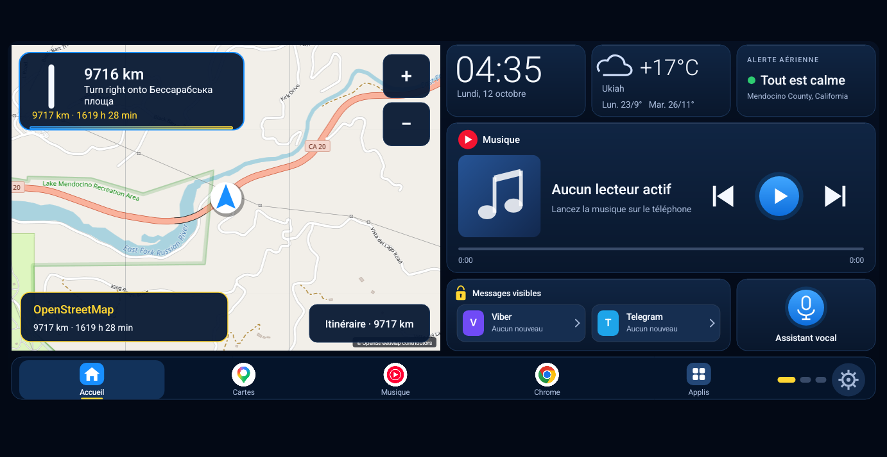

# XiaoDroidLink — Guide utilisateur

Langues : [English](README.md) · [Українська](README.ua.md) · [中文](README.zh.md) · [Français](README.fr.md) · [Español](README.es.md) · [Deutsch](README.de.md) · [Polski](README.pl.md) · [Қазақша](README.kk.md) · [Azərbaycanca](README.az.md) · [Oʻzbekcha](README.uz.md) · [Тоҷикӣ](README.tg.md) · [ქართული](README.ka.md) · [Հայերեն](README.hy.md) · [Кыргызча](README.ky.md)

XiaoDroidLink connecte un téléphone Android à l'écran Xiaomi YU7 via CarLink. L'application peut afficher un tableau de bord ou l'écran du téléphone dans la voiture, contrôler la musique, ouvrir les applications choisies, renvoyer les gestes tactiles de l'écran de la voiture vers le téléphone et utiliser Google Maps par diffusion d'écran.

Ce projet est indépendant. Ce n'est pas un produit officiel Xiaomi, Samsung, ICCOA, Android Auto ou Google.

## Fonctionnalités

- Connexion CarLink avec Xiaomi YU7.
- Appairage par code à 6 chiffres affiché dans la voiture.
- Écran d'accueil composé de widgets : jusqu'à trois écrans, cinq modèles prêts, 23 widgets (carte, prochain virage, vitesse, radars, bornes, itinéraires Domicile/Travail, musique, messages, contacts, agenda, fenêtre d'une appli du téléphone, etc.). Disposez-les, redimensionnez-les et réglez-les sur l'écran de la voiture : roue dentée → Widgets.
- Huit styles avec des aperçus carte, média et trajet. Le bouton Écrans 1/3 › du dock fait défiler les trois écrans ; la roue dentée ouvre le catalogue des styles.
- Carte d'appel entrant avec les boutons Répondre et Refuser.
- Mode écran du téléphone : affichage des applications du téléphone sur l'écran de la voiture.
- Commandes tactiles de la voiture vers le téléphone via le service d'accessibilité Android.
- Commandes média : lecture/pause, piste précédente, piste suivante.
- Appli de carte choisie dans le tableau de bord via la diffusion de l'écran du téléphone ; Google Maps reste le choix par défaut.
- Audio via CarLink lorsque l'audio Bluetooth ne fonctionne pas.
- Sélection des applications affichées dans la voiture.
- Alertes vocales pour radars et alertes aériennes.
- Assistant de la voiture dans votre langue : bouton du volant, une commande, et le téléphone la transmet en chinois à la voiture.
- Langues (14) : English, Українська, 中文, Français, Español, Deutsch, Polski, Қазақша, Azərbaycanca, Oʻzbekcha, Тоҷикӣ, ქართული, Հայերեն, Кыргызча.

## Vidéos

Présentation en anglais (49 s) :

[](https://www.youtube.com/shorts/3C1UO75dUE4)

Chaque fonction et widget en détail (en anglais) : [All features](FEATURES.md) · [Home screen widgets](WIDGETS.md).

## Installer depuis Google Play

XiaoDroidLink est disponible sur Google Play.

1. Ouvrez XiaoDroidLink dans Google Play sur le téléphone : [https://play.google.com/store/apps/details?id=salon.lifestyle.xiaodroidlink](https://play.google.com/store/apps/details?id=salon.lifestyle.xiaodroidlink)
2. Touchez « Installer ».
3. Ouvrez XiaoDroidLink.

Les mises à jour arrivent automatiquement par Google Play.

Si vous aviez installé XiaoDroidLink depuis un fichier APK, désinstallez-le d'abord : l'APK et la version Google Play sont signés différemment, Google Play ne peut donc pas l'installer par-dessus. Après la réinstallation, saisissez de nouveau le code affiché par la voiture.

## Quels téléphones

- Android 13 ou plus récent.
- Testé dans la voiture avec un Samsung Galaxy S25 Ultra.
- Les téléphones à encodeur vidéo plus faible (beaucoup de MediaTek et Unisoc, p. ex. Infinix, Tecno, certains Galaxy A) envoient à la voiture une image un peu plus petite aux mêmes proportions. « Aperçu sans voiture » y fonctionne (vérifié sur un Infinix Hot 40) ; dans la voiture ce n'est pas encore testé. Si l'image ne remplit pas l'écran ou n'apparaît pas, écrivez à xiaodroidlink@lifestyle.salon.

## Captures d'écran

Le bouton d'aperçu sans voiture de l'application permet de voir le tableau de bord sur le téléphone.

| Aperçu sur l’écran de la voiture |
|---|
|  |

| Écran 2 sur 3 : médias | Écran 3 sur 3 : trajet |
|---|---|
|  |  |

| Catalogue de designs |
|---|
|  |

| Écran principal | Autorisations |
|---|---|
|  |  |

| Réglages |
|---|
|  |

## Première configuration

Dans XiaoDroidLink, ouvrez la section Permissions et accordez les accès nécessaires :

- Bluetooth, position, microphone, notifications — pour trouver la voiture, le Wi-Fi, l'audio et les notifications.
- Accès aux notifications — pour la musique, Google Maps et les messages.
- Accessibilité — pour contrôler les applications du téléphone depuis l'écran de la voiture.
- Modification des paramètres système — pour l'orientation correcte de l'écran.
- Batterie sans restriction — pour éviter qu'Android coupe la connexion en arrière-plan.
- Diffusion de l'écran — pour Google Maps et le mode écran du téléphone.

## Connexion à la voiture

1. Ouvrez CarLink sur l'écran Xiaomi YU7.
2. Ouvrez XiaoDroidLink sur le téléphone.
3. Touchez Connect.
4. Si Android demande la diffusion d'écran, choisissez Entire screen puis Start.
5. L'écran de la voiture affiche un code à 6 chiffres.
6. Entrez ce code dans XiaoDroidLink.
7. Après la connexion, choisissez Dashboard ou Phone screen.
8. À la fin du trajet, touchez Disconnect dans l'application ou la notification.

## Appels et voix par le Bluetooth de la voiture

La musique arrive dans la voiture par CarLink (Wi‑Fi). Les appels, la voix de navigation et ChatGPT passent par le Bluetooth de la voiture, qu'il faut connecter séparément. Faites-le à l'arrêt.

1. Connectez-vous à la voiture comme décrit ci-dessus et attendez l'image sur son écran.
2. Le téléphone affiche la notification `Le Bluetooth de la voiture n'est pas connecté`. Touchez-la.
3. L'application arrête elle-même la connexion et ouvre les réglages Bluetooth. Choisissez votre voiture dans la liste.
4. Ne touchez à rien d'autre. En quelques secondes l'application se reconnecte et l'image revient.
5. Vérifiez : un appel ou la voix de ChatGPT doit sortir des haut-parleurs de la voiture.

Bon à savoir :

- Ne connectez pas le Bluetooth de la voiture à l'avance, avant de lancer CarLink. La voiture coupe cette connexion au démarrage de CarLink. Le chemin fiable est celui de la notification.
- Si le Bluetooth est affiché comme connecté mais que les appels sortent toujours du téléphone, touchez la même notification et choisissez de nouveau la voiture.
- Le téléphone ne se connecte pas seul au Bluetooth de la voiture. Il faut choisir la voiture à la main une fois au début du trajet.
- Vous avez 90 secondes pour choisir la voiture. Passé ce délai, l'application revient à l'écran de la voiture sans Bluetooth et la notification réapparaît.
- Ensuite, ne fermez pas CarLink sur l'écran de la voiture. Tant qu'il reste ouvert, le Bluetooth tient malgré les coupures et les nouvelles connexions. Si vous le fermez et le rouvrez, refaites les étapes.
- Avec le Bluetooth connecté, la musique démarre dans la voiture environ 10 secondes après l'image. Ce délai est voulu, pour que la voiture ne coupe pas le Bluetooth.
- Le YU7 n'accepte pas la musique par Bluetooth pendant CarLink, donc `Son via CarLink` doit rester activé.
- Testé sur le Xiaomi YU7 Max. Il arrive que la voiture coupe quand même le Bluetooth : refaites les étapes 2 à 4.

## Assistant de la voiture dans votre langue

L'assistant de la voiture (XiaoAI, 超级小爱) ne comprend que le chinois. XiaoDroidLink traduit pour lui : vous dites une commande dans votre langue, le téléphone la répète en chinois **par son propre haut-parleur**, et la voiture l'exécute. Vous pouvez ainsi piloter le climat, les sièges, les vitres, le coffre avant, les essuie-glaces, les feux et le thème de l’écran.

Les commandes sont comprises en ukrainien, russe, anglais, français et espagnol, et depuis la 7.67 aussi en allemand, polonais, kazakh, azerbaïdjanais, ouzbek, tadjik, géorgien, arménien et kirghiz. Dans ces neuf langues, les commandes sont traduites mais pas encore testées dans la voiture.

### Activer

1. Sur le téléphone : XiaoDroidLink → Réglages → l'interrupteur **« Assistant de la voiture dans votre langue »**.
2. Autorisez le micro si le téléphone le demande.
3. Le téléphone a besoin d'une voix chinoise de synthèse vocale. Samsung et Google l'ont en général déjà. Sinon, la voiture affiche une aide : Paramètres → Synthèse vocale → installez le chinois.

Interrupteur désactivé, le bouton de l'assistant au volant ouvre comme avant l'IA du téléphone (ChatGPT, Gemini ou l'assistant système choisi dans « Bouton micro »).

### Utiliser

1. Appuyez sur le **bouton de l'assistant au volant** (molette gauche). L'assistant de la voiture se réveille et le téléphone écoute en même temps. La voiture affiche « Dites ce que la voiture doit faire… ».
2. Dites une commande, par exemple « ouvre le capot ».
3. Environ 3 secondes plus tard, le téléphone la dit en chinois, la voiture l'exécute et répond (en chinois aussi). Si le téléphone n'a pas reconnu la phrase, la voiture affiche « Pas compris : … ».

Pour parler à l'**IA du téléphone**, appuyez sur le bouton du volant et dites « intelligence artificielle », « AI », « ChatGPT » ou « Gemini ». Le téléphone demande à l'assistant de la voiture de quitter (« 退出小爱 ») et ouvre l'IA.

**Appels à la voix :** appuyez sur le bouton du volant et dites « appelle Olena », « appelle maman ». Le téléphone cherche le nom dans ses contacts et appelle ; s'il y en a plusieurs, l'écran de la voiture en propose jusqu'à trois. La première fois, autorisez l'accès aux contacts sur le téléphone. Si le Bluetooth de la voiture n'est pas connecté, le téléphone n'appelle pas (la conversation passerait par son haut-parleur) : il ouvre le choix de la voiture et vous demande de rappeler.

**La réponse de la voiture à l'écran :** après une commande, le téléphone écoute la réponse en chinois de la voiture et l'affiche sur l'écran de la voiture dans votre langue (traduite par Google Traduction, Internet nécessaire).

**Liste des commandes à l'écran :** dans la voiture, engrenage → **« 🗣 Commandes de l'assistant »** (en haut des réglages) ; sur le téléphone, le bouton **« Commandes de l'assistant »** sous l'interrupteur « Assistant de la voiture dans votre langue ». Seules les commandes vérifiées dans la voiture y figurent, ainsi que ce que la voiture ne fait pas à la voix.

### Ce que vous pouvez dire

Parlez normalement. Le téléphone cherche ce que vous voulez changer et s'il faut allumer ou éteindre (« éteins », « ferme » veulent dire éteindre).

| Quoi | Exemples |
|---|---|
| Température | « plus chaud », « plus frais », « température 22 », « allume la clim », « éteins la clim » |
| Sièges | « siège chauffant », « éteins le siège chauffant », « siège ventilé », « éteins la ventilation », « massage » |
| Volant, vitre, rétros | « volant chauffant », « dégivrage arrière », « désembuage du pare-brise », « rétros chauffants » |
| Vitres | « ouvre les vitres », « ferme les vitres » |
| Coffres | « ouvre le capot » (ou « coffre avant »), « ferme le capot », « ouvre le coffre », « ferme le coffre » |
| Trappe de charge | « ouvre la trappe de charge », « ferme la trappe de charge » |
| Rétroviseurs | « rabats les rétros », « déplie les rétros » |
| Essuie-glaces | « essuie-glaces », « lave-glace » |
| Feux | « allume la lumière », « éteins la lumière » (habitacle), « antibrouillard » (arrière), « éclairage d'ambiance rouge », « éclairage d'ambiance bleu » |
| Thème de l'écran | « thème clair », « thème sombre » |
| IA du téléphone | « intelligence artificielle », « AI », « ChatGPT », « Gemini » |

Pour le siège chauffant, vous pouvez préciser « conducteur » ou « passager » : « siège chauffant passager », « siège chauffant conducteur », « sièges arrière chauffants ». La voiture n’allume pas les feux de route à la voix, seulement avec la manette gauche ; le téléphone vous le dit.

Seules les commandes vérifiées dans la voiture les 25 et 26 octobre 2026 figurent ici. Le téléphone en comprend d’autres (modes de conduite, batterie et autonomie, volume en chiffres) ; nous les testons encore et les ajouterons ici. C’est la voiture qui décide d’exécuter : certaines actions peuvent n’être permises qu’à l’arrêt.

### Limites

- Il faut le **bouton du volant**. Le téléphone ne peut pas réveiller l'assistant avec « 小爱同学 » : la voiture clignote brièvement et n'écoute pas la suite (testé avec tous les réglages d'activation vocale).
- Gardez le téléphone **dans l'habitacle** (sur le chargeur ou un support), pas dans une poche ou un sac : la voiture doit entendre son haut-parleur.
- La voiture répond en chinois ; sa réponse s'affiche traduite sur l'écran de la voiture.

## Réglages recommandés

- Gardez le téléphone déverrouillé pour Google Maps ou le mode écran du téléphone.
- Activez Google Maps in the dashboard si vous voulez la carte dans le tableau de bord. Utilisez Dashboard map app pour choisir Waze ou une autre appli installée.
- Activez Audio through CarLink seulement si l'audio Bluetooth ne fonctionne pas.
- Ajoutez les applications nécessaires dans Apps in the car.
- Après la première connexion réussie, vous pouvez laisser Auto-connect activé.

## Dépannage

Liste complète des messages affichés sur le téléphone et dans la voiture, avec captures d'écran (en anglais) : [erreurs à l'écran et solutions](TROUBLESHOOTING.md).

### La voiture est introuvable

- Ouvrez d'abord CarLink sur l'écran de la voiture.
- Fermez puis rouvrez CarLink dans la voiture.
- Désactivez puis réactivez le Bluetooth du téléphone.
- Vérifiez que l'autorisation de position est accordée.
- Rapprochez le téléphone de la voiture.

### Le code n'est pas accepté

- Entrez le code le plus récent affiché dans la voiture.
- Si le code a changé, entrez le nouveau.
- Fermez puis rouvrez CarLink dans la voiture.
- Touchez Disconnect et recommencez.

### Le Wi-Fi de la voiture ne se connecte pas

- Gardez CarLink ouvert pendant la connexion.
- Désactivez le VPN ou ajoutez XiaoDroidLink aux exceptions du VPN.
- Désactivez puis réactivez le Wi-Fi du téléphone.
- Si le téléphone se connecte à un ancien réseau, oubliez l'ancien Wi-Fi de la voiture.

### La diffusion d'écran ne démarre pas

- Quand Android le demande, choisissez Entire screen.
- Gardez le téléphone déverrouillé.
- Vérifiez que XiaoDroidLink n'a pas de restriction batterie.
- Fermez puis rouvrez l'application.

### Le tactile de la voiture ne fonctionne pas

- Activez XiaoDroidLink dans les paramètres d'accessibilité Android.
- Si Android bloque l'option, autorisez les réglages restreints dans la fiche de l'application.
- Après l'activation de l'accessibilité, déconnectez puis reconnectez.

### Les commandes musique ne fonctionnent pas

- Accordez l'accès aux notifications à XiaoDroidLink.
- Lancez la musique sur le téléphone.
- Vérifiez le réglage Music button player.
- Rouvrez XiaoDroidLink après avoir accordé l'accès aux notifications.

### Le son sort encore du téléphone

- Connectez le téléphone au Bluetooth de la voiture.
- Si l'audio Bluetooth ne fonctionne pas, activez Audio through CarLink.
- Après le changement audio, déconnectez puis reconnectez.

### La carte ne s'affiche pas

- Activez Google Maps in the dashboard.
- Autorisez la diffusion de l'écran.
- Gardez le téléphone déverrouillé.
- Lancez la navigation dans l’application de carte choisie sur le téléphone.

### La connexion s'arrête en arrière-plan

- Désactivez les restrictions batterie pour XiaoDroidLink.
- Ne forcez pas la fermeture de l'application.
- Gardez la notification de connexion active.
- Si le téléphone a un gestionnaire batterie, ajoutez XiaoDroidLink à la liste blanche.

## Journaux de diagnostic

Dans l'application :

```text
Diagnostics -> Show log
```

Fichier sur le téléphone :

```text
Android/data/salon.lifestyle.xiaodroidlink/files/probe.log
```

## Support

Assistance : xiaodroidlink@lifestyle.salon
