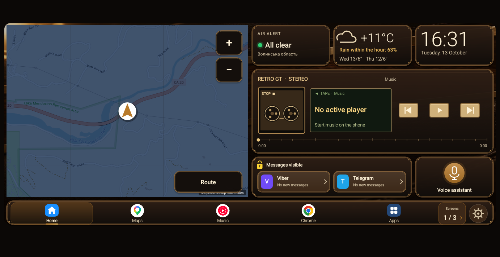
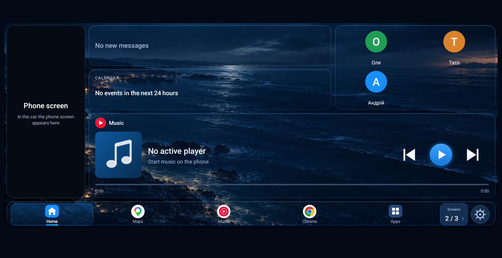
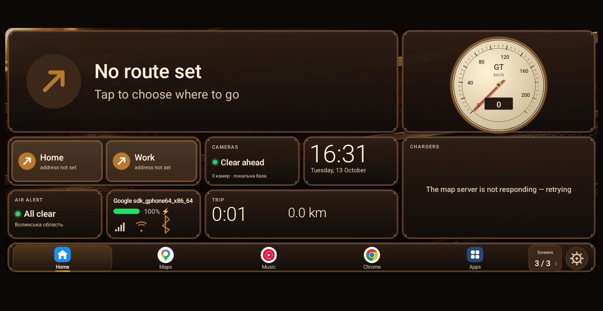
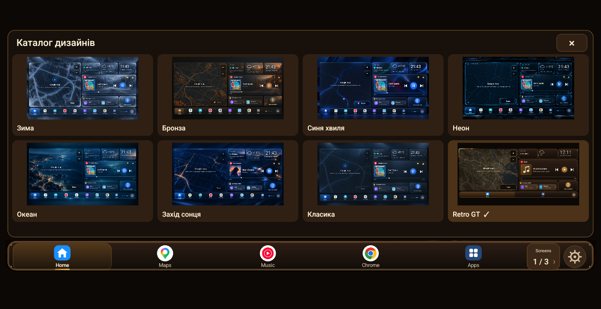

# XiaoDroidLink — User Guide

Languages: [English](README.md) · [Українська](README.ua.md) · [中文](README.zh.md) · [Français](README.fr.md) · [Español](README.es.md)

XiaoDroidLink connects an Android phone to the Xiaomi YU7 screen through CarLink. It can show a dashboard or the phone screen in the car, control music, open selected apps, send car-screen touches back to the phone, and use Google Maps through screen casting.

This is an independent app. It is not an official Xiaomi, Samsung, ICCOA, Android Auto, or Google product.

## Features

- Xiaomi YU7 CarLink connection.
- 6-digit code pairing from the car screen.
- Widget home screen: three ready-made screens plus a blank fourth for your own layout, five presets and 23 widgets. The Edit button beside the screen switcher opens the editor on the car display.
- Apps menu on the car screen: tap Edit to add or remove phone apps without touching the phone. Popular installed apps appear there on first start.
- Eight visual designs with map, media, and trip previews. The dock's Screens 1/4 › button cycles through four screens; gear → design catalog opens the style picker.
- Every design has day and night artwork. Gear → Dashboard theme offers Auto (by sun), Dark, and Light; gear → Bottom dock changes five app shortcuts and the Music button player.
- Incoming call card with Answer and Decline buttons.
- Phone screen mode: show phone apps on the car display.
- Touch control from the car screen through Android Accessibility.
- Media controls: play/pause, previous track, next track.
- Selected map app in the dashboard through phone screen casting; Google Maps is the default.
- Built-in practical navigation on the OpenStreetMap map: address search, up to five address results, alternative routes, turn-by-turn instructions, remaining distance and time, automatic rerouting, and voice guidance.
- Audio through CarLink when Bluetooth audio does not work.
- App picker for apps shown in the car.
- Voice warnings for speed cameras and air alerts.
- Car assistant in your language: press the steering wheel button, say a command, and the phone tells the car in Chinese.
- Languages: English, Ukrainian, Chinese, French, and Spanish.

## Videos

Presentation in English (49 s):

[](https://www.youtube.com/shorts/3C1UO75dUE4)

Every feature and widget in detail: [All features](FEATURES.md) · [Home screen widgets](WIDGETS.md).

## Install from Google Play

XiaoDroidLink is available on Google Play.

1. Open XiaoDroidLink in Google Play on your phone: [https://play.google.com/store/apps/details?id=salon.lifestyle.xiaodroidlink](https://play.google.com/store/apps/details?id=salon.lifestyle.xiaodroidlink)
2. Tap "Install".
3. Open XiaoDroidLink.

Updates arrive through Google Play automatically.

If you installed XiaoDroidLink from an APK file before, uninstall it first: the APK and the Google Play version are signed differently, so Google Play cannot install over it. After reinstalling, enter the code from the car screen again.

## Which phones work

- Android 13 or newer.
- Tested in the car with a Samsung Galaxy S25 Ultra.
- Phones with a weaker video encoder (many MediaTek and Unisoc phones, e.g. Infinix, Tecno, some Galaxy A) send the car a slightly smaller picture with the same proportions. "Preview without car" works on them (checked on an Infinix Hot 40); in the car this has not been tested yet — if the picture does not fill the screen or does not appear, please write to xiaodroidlink@lifestyle.salon.

## Screenshots

Tap Preview without car in the phone app to inspect the dashboard.

| Car screen preview |
|---|
|  |

| Screen 2 of 3: media | Screen 3 of 3: trip |
|---|---|
|  |  |

| Design catalog |
|---|
|  |

| Main screen | Permissions |
|---|---|
|  |  |

| Settings |
|---|
|  |

## First Setup

Open the Permissions section in XiaoDroidLink and grant what the app needs:

- Bluetooth, location, microphone, notifications — for car discovery, Wi-Fi, audio, and notifications.
- Notification access — for music, Google Maps directions, and messages.
- Accessibility — for touch control from the car screen into phone apps.
- Modify system settings — for correct screen orientation.
- Unrestricted battery — so Android does not stop the connection in the background.
- Screen casting — for Google Maps and phone screen mode.

## Connect To The Car

1. Open CarLink on the Xiaomi YU7 screen.
2. Open XiaoDroidLink on the phone.
3. Tap Connect.
4. If Android asks for screen casting, choose Entire screen and tap Start.
5. The car screen will show a 6-digit code.
6. Enter that code in XiaoDroidLink.
7. After connection, choose Dashboard or Phone screen mode.
8. When the trip is finished, tap Disconnect in the app or notification.

## Calls And Voice Through The Car's Bluetooth

Music reaches the car through CarLink (Wi‑Fi). Calls, navigation voice and ChatGPT go through the car's Bluetooth, which has to be connected separately. Do this while parked.

1. Connect to the car as described above and wait for the picture on its screen.
2. The phone shows the notification `The car's Bluetooth is not connected`. Tap it.
3. The app stops the connection by itself and opens Bluetooth settings. Pick your car in the list.
4. Do not tap anything else. In a few seconds the app connects again and the picture returns.
5. Check: a call or the ChatGPT voice should play from the car speakers.

Good to know:

- Do not connect the car's Bluetooth in advance, before CarLink starts. The car drops such a connection when CarLink starts. The notification path is the one that works reliably.
- If Bluetooth is shown as connected but calls still play from the phone, tap the same notification and pick the car again.
- The phone does not connect to the car's Bluetooth by itself. You pick the car by hand once at the start of a trip.
- You have 90 seconds to pick the car. If you run out of time, the app returns to the car screen without Bluetooth and the notification appears again.
- After that, do not close CarLink on the car screen. While it stays open, Bluetooth survives drops and new connections. If you close and reopen it, repeat the steps.
- With Bluetooth connected, music starts in the car about 10 seconds after the picture. The delay is deliberate, so that the car does not drop Bluetooth.
- The YU7 does not accept music over Bluetooth while CarLink runs, so `Audio through CarLink` must stay on.
- Tested on the Xiaomi YU7 Max. Now and then the car still drops Bluetooth — repeat steps 2–4.

## Car Assistant In Your Language

The car assistant (XiaoAI, 超级小爱) understands only Chinese. XiaoDroidLink translates for it: you say a command in your language, the phone repeats it in Chinese **through its own speaker**, and the car does it. This way you can control climate, seats, windows, the front trunk, wipers, lights and the screen theme.

### Turn It On

1. On the phone: XiaoDroidLink → Settings → the **"Car assistant in your language"** switch.
2. Allow microphone access if the phone asks.
3. The phone needs a Chinese text-to-speech voice. Samsung and Google usually have it already. If not, the car shows a hint: Settings → Text-to-speech → install Chinese.

With the switch off, the steering wheel assistant button opens the phone AI as before (ChatGPT, Gemini or the system assistant chosen in "Microphone button").

### Use It

1. Press the **assistant button on the steering wheel** (the left scroll wheel). The car assistant wakes up and the phone listens at the same time. The car shows "Say what the car should do…".
2. Say a command, for example "open the front trunk".
3. About 3 seconds later the phone says it in Chinese, and the car does it and answers (also in Chinese). If the phone did not recognise the phrase, the car shows "Didn't understand: …".

To talk to the **phone AI**, press the wheel button and say "artificial intelligence", "AI", "ChatGPT" or "Gemini". The phone asks the car assistant to quit ("退出小爱") and opens the AI.

**Command list on the screen:** in the car, gear → **"🗣 Assistant commands"** (top of the settings); on the phone, the **"Assistant commands"** button under the "Car assistant in your language" switch. Both show only the commands verified in the car, plus what the car does not do by voice.

### What You Can Say

Use ordinary words. The phone looks for what you want to change and whether it is on or off ("off", "close", "fold" mean off).

In Ukrainian the app also understands Russian and mixed words ("открой окно", "выключи кондиционер", "подогрев руля").

| What | Example phrases |
|---|---|
| Temperature | "warmer", "cooler" |
| Seats | "seat heating", "turn off seat heating", "seat ventilation", "turn off ventilation", "seat massage" |
| Wheel, glass, mirrors | "steering wheel heating", "rear defrost", "windshield defog", "mirror heating" |
| Windows | "open the windows", "close the windows" |
| Front and rear trunk | "open the front trunk" (or "hood", "frunk"), "open the trunk", "close the trunk" |
| Charge port | "open the charge port", "close the charge port" |
| Mirrors | "fold the mirrors", "unfold the mirrors" |
| Wipers | "turn on the wipers", "washer" |
| Lights | "turn on the light", "turn off the light" (cabin), "fog light" (rear) |
| Screen theme | "light theme", "dark theme" |
| Phone AI | "artificial intelligence", "AI", "ChatGPT", "Gemini" |

For seat heating you can add "driver" or "passenger": "passenger seat heating", "driver seat heating", "rear seat heating". The car does not switch the high beam by voice, only with the left stalk; the phone tells you so.

Only commands verified in the car on 25–26 October 2026 are listed. The phone understands more (temperature as a number, drive modes, ambient light and colours, battery and range, volume as a number); we are still testing them and will add them here. The car itself decides whether to do a command: some actions may be allowed only when parked.

### Limitations

- You need the **steering wheel button**. The phone cannot wake the car assistant with "小爱同学": the car only flashes briefly and stops listening (tested with every voice wake setting).
- Keep the phone **in the cabin** (on the charger or in a holder), not in a pocket or bag: the car has to hear its speaker.
- The **front trunk cannot be closed by voice**, only opened: the car does not allow it.
- The car answers in Chinese.
- If the app language is Chinese, the phone passes the phrase as is. In Chinese you can also simply talk to the car assistant.

## Recommended Settings

- Keep the phone unlocked when using Google Maps or phone screen mode.
- In **Dashboard map app**, choose built-in OpenStreetMap or Google Maps, Waze, or another installed phone map.
- If screen casting is unavailable, the dashboard keeps its built-in OpenStreetMap map and does not open Google Maps, Waze, or another phone map app.
- Music does not require screen casting: the Music button resumes the active or last phone player, including YouTube Music, while the dashboard stays visible.
- Turn on Audio through CarLink only if the car does not accept Bluetooth audio.
- Add the apps you need in Apps in the car.
- After the first successful connection, you can keep Auto-connect enabled.

## Built-in Navigation

1. In **What to show in the car**, tap **Plan a route**.
2. Enter a city, street, and house number, then tap **Search**. Search only runs after this tap; the app does not send each typed character to the search service.
3. Choose the correct address and one of the proposed routes.
4. The dashboard switches to its embedded OpenStreetMap view and shows the route, next turn, remaining distance, and estimated travel time.
5. If the car moves more than 80 metres away from the route for three consecutive location updates, the app requests a new route. If that request fails, guidance continues on the previous route.
6. Tap **Navigation active** in the phone app to choose a new destination or stop navigation.

Address search uses Nominatim and route calculation uses OSRM. Both endpoints are configurable in app preferences for deployments that use a self-hosted or commercial service. An internet connection is required for a new search, route, or map area; recently downloaded map tiles and exact repeated searches remain cached.

You can also plan the route entirely from the car screen. On the built-in OpenStreetMap map, tap **Route**, enter the address with the on-screen keyboard, tap **Search**, then choose an address and route. Drag the map with one finger in any direction and use **+** and **−** to inspect another zoom level. Tap **Driving ↑** to return to zoom 15 with the car centred and the direction of travel at the top, like the navigation view in Google Maps. While navigation is active, tap **Route** again to plan another route or stop navigation.

The built-in map draws its own blue vehicle arrow. While moving, it uses the phone/car bearing when available and otherwise calculates direction from consecutive GPS positions, so the map can keep the direction of travel at the top without screen casting.

**Inertial map guidance** is enabled by default. It combines the car speed, smoothed heading, and GPS corrections to move the map between location fixes and bridge a signal loss for up to about ten seconds. Large position differences still snap to the new GPS fix. This reduces ordinary GPS jitter and short interruptions; it is not protection against deliberate GNSS spoofing, and its error grows without a valid position or steering/yaw data.

## Troubleshooting

Full list of phone and car screen messages, with screenshots of what to turn on: [on-screen errors and how to fix them](TROUBLESHOOTING.md).

### The car is not found

- Open CarLink on the car screen.
- Close CarLink on the car screen and open it again.
- Turn Bluetooth off and on on the phone.
- Check that location permission is granted.
- Move the phone closer to the car.

### The code is not accepted

- Enter the newest code shown on the car screen.
- If the code changed, enter the new one.
- Close and reopen CarLink on the car screen.
- Tap Disconnect and start again.

### Car Wi-Fi does not connect

- Keep CarLink open on the car screen while connecting.
- Turn off VPN or add XiaoDroidLink to the VPN exception list.
- Turn Wi-Fi off and on on the phone.
- If the phone connects to an old network, forget the old car Wi-Fi network.

### Screen casting does not start

- When Android asks, choose Entire screen.
- Keep the phone unlocked.
- Check that battery restrictions are disabled for XiaoDroidLink.
- Close and reopen the app.

### Car touch does not work

- Enable XiaoDroidLink in Android Accessibility settings.
- If Android blocks the option, allow restricted settings on the app info screen.
- After enabling Accessibility, disconnect and connect again.

### Music controls do not work

- Grant Notification access to XiaoDroidLink.
- Start music on the phone.
- Check the Music button player setting.
- Reopen XiaoDroidLink after granting notification access.

### Audio still plays from the phone

- Connect the phone to the car Bluetooth.
- If Bluetooth audio does not work, turn on Audio through CarLink.
- After changing audio settings, disconnect and connect again.

### The map does not appear

- Turn on Google Maps in the dashboard.
- Allow screen casting.
- Keep the phone unlocked.
- Start navigation in the selected map app on the phone.

### Built-in navigation cannot find or build a route

- Check that the phone has a current location and internet access.
- Enter a complete address and choose one of the returned address variants.
- Public routing services can be temporarily unavailable. The active route remains on screen if automatic rerouting fails.

### The connection stops in the background

- Disable battery restrictions for XiaoDroidLink.
- Do not force-close the app.
- Keep the active connection notification.
- If your phone has a custom battery manager, add XiaoDroidLink to its whitelist.

## Diagnostic Logs

In the app:

```text
Diagnostics -> Show log
```

File on the phone:

```text
Android/data/salon.lifestyle.xiaodroidlink/files/probe.log
```

## Support

Support: xiaodroidlink@lifestyle.salon
