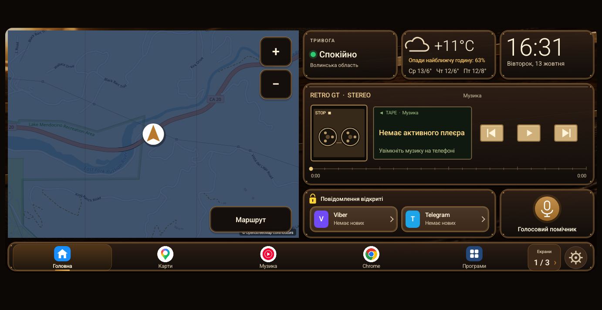
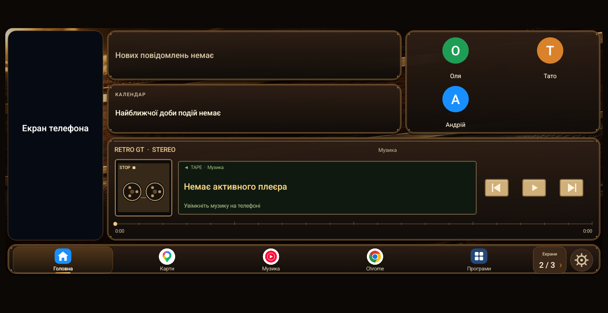
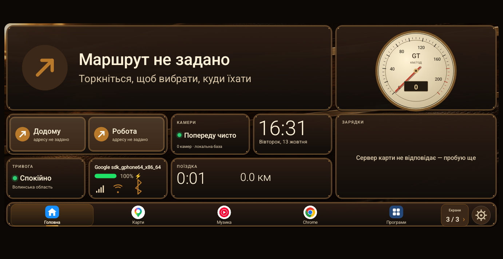
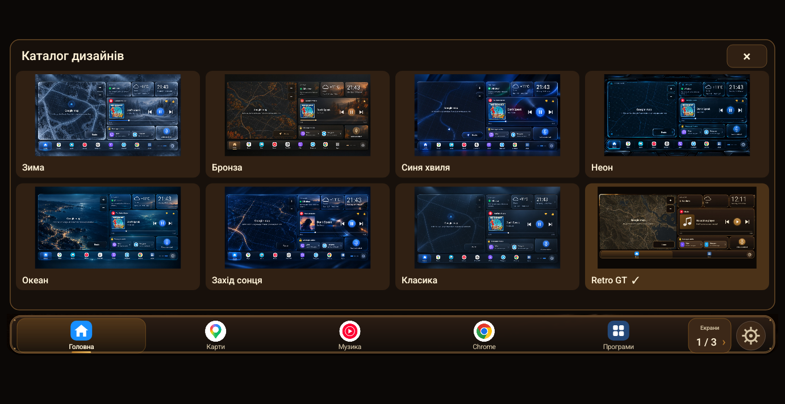
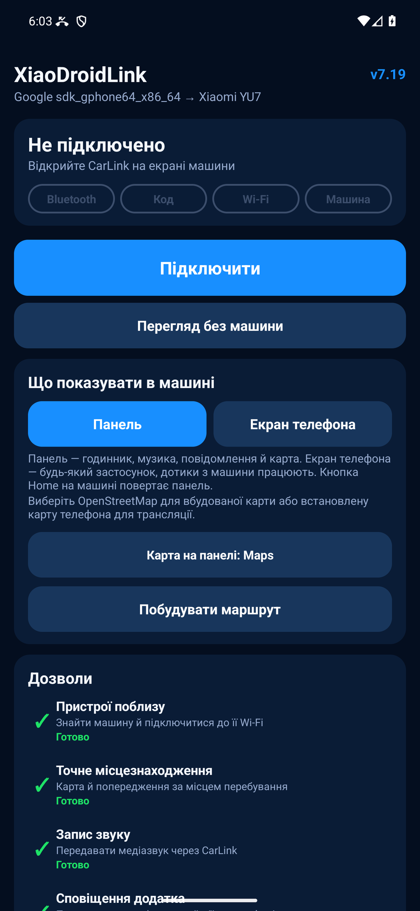
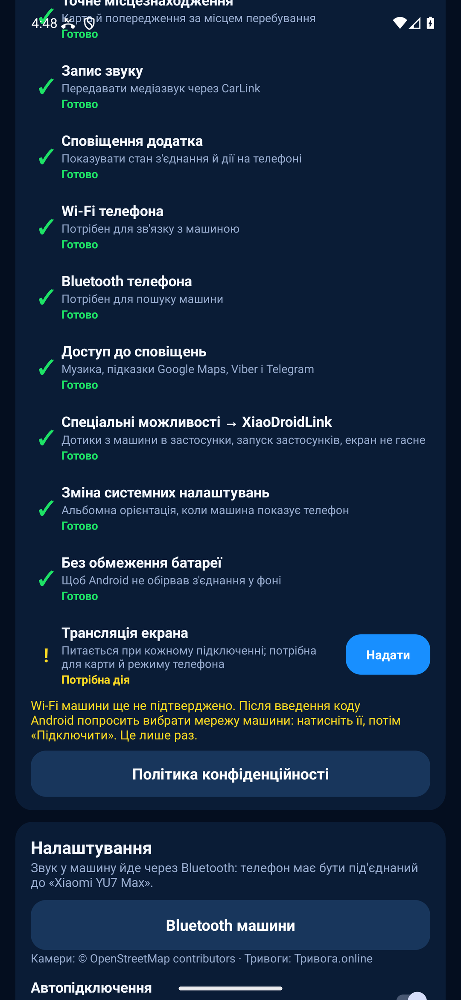
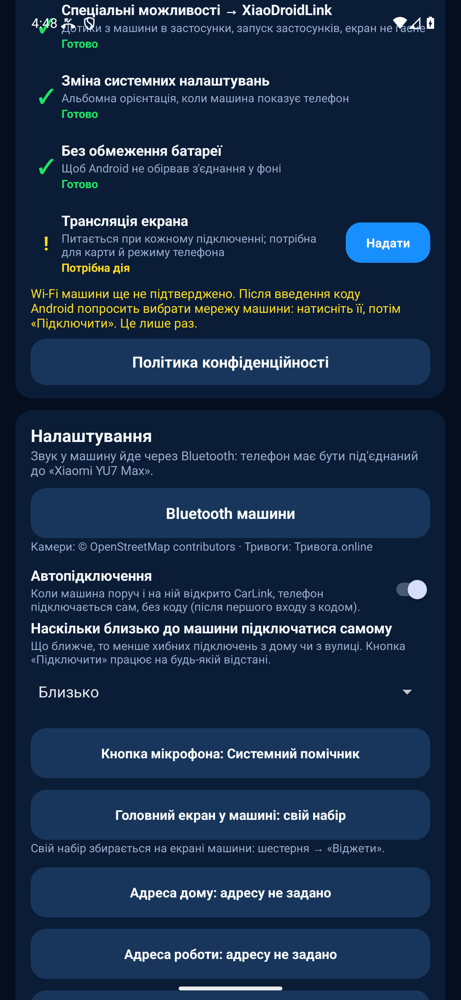

# XiaoDroidLink — інструкція для користувача

Мови: [English](README.md) · [Українська](README.ua.md) · [中文](README.zh.md) · [Français](README.fr.md) · [Español](README.es.md) · [Deutsch](README.de.md) · [Polski](README.pl.md) · [Қазақша](README.kk.md) · [Azərbaycanca](README.az.md) · [Oʻzbekcha](README.uz.md) · [Тоҷикӣ](README.tg.md) · [ქართული](README.ka.md) · [Հայերեն](README.hy.md) · [Кыргызча](README.ky.md) · [Русский](README.ru.md)

XiaoDroidLink підключає Android-телефон до екрана Xiaomi YU7 через CarLink. Застосунок дозволяє показувати панель або екран телефона в машині, керувати музикою, відкривати вибрані програми, передавати дотики з екрана машини назад у телефон і використовувати Google Maps через трансляцію екрана.

Це незалежний застосунок. Він не є офіційним продуктом Xiaomi, Samsung, ICCOA, Android Auto або Google.

## Що є в застосунку

- Підключення до Xiaomi YU7 через CarLink.
- Введення 6-значного коду з екрана машини.
- Головний екран із віджетів: три готові екрани й четвертий порожній для власного набору, п'ять готових розкладок, 23 віджети. Кнопка «Редагувати» біля перемикача екранів відкриває редактор на екрані машини.
- Меню «Програми» на екрані машини: кнопка «Змінити» додає чи прибирає програми телефона без телефона в руках. При першому запуску туди самі потрапляють популярні встановлені програми.
- Вісім дизайнів із зразками карти, медіа й поїздки. Кнопка «Екрани 1/4 ›» у доку перемикає чотири екрани; шестерня → «Каталог дизайнів» відкриває вибір стилю.
- Кожен дизайн має денний і нічний варіант. Шестерня → «Тема панелі» перемикає «Авто» (за сонцем), «Темна» й «Світла»; «Нижня панель» змінює п'ять ярликів і плеєр кнопки «Музика».
- Картка вхідного дзвінка з кнопками «Прийняти» й «Відхилити».
- Режим `Екран телефона`: показ застосунків телефона на дисплеї машини.
- Дотики з екрана машини в телефон через спеціальні можливості Android.
- Керування музикою: play/pause, попередній і наступний трек.
- Вибрана карта в панелі через трансляцію екрана телефона; Google Maps стоїть за замовчуванням.
- Вбудована практична навігація на карті OpenStreetMap: пошук адреси, до п’яти варіантів адреси, альтернативні маршрути, повороти, відстань і час, автоматичне перепрокладання та голосові підказки.
- Передача звуку через CarLink, якщо Bluetooth-аудіо не працює.
- Вибір програм, які будуть доступні в машині.
- Голосові попередження про камери швидкості й повітряну тривогу — у підголовник водія, мовою застосунку (якщо голосу цієї мови на телефоні немає — англійською). Камери завантажуються для всієї країни, де ти зараз, і в Україні, і за кордоном.
- Помічник машини українською: натискаєш кнопку на кермі, кажеш команду, і телефон перекаже її машині китайською.
- Мови (15): English, Українська, 中文, Français, Español, Deutsch, Polski, Қазақша, Azərbaycanca, Oʻzbekcha, Тоҷикӣ, ქართული, Հայերեն, Кыргызча, Русский.

## Відео

Презентація українською (50 с):

[](https://www.youtube.com/shorts/dEqKUfcbPsQ)

Докладно про кожну функцію й віджет: [Усі можливості](FEATURES.ua.md) · [Віджети головного екрана](WIDGETS.ua.md).

## Встановити з Google Play

XiaoDroidLink є в Google Play.

1. Відкрий XiaoDroidLink у Google Play на телефоні: [https://play.google.com/store/apps/details?id=salon.lifestyle.xiaodroidlink](https://play.google.com/store/apps/details?id=salon.lifestyle.xiaodroidlink)
2. Натисни «Встановити».
3. Відкрий XiaoDroidLink.

Оновлення приходять через Google Play самі.

Якщо раніше ти ставив XiaoDroidLink з APK-файлу, спершу видали його: APK і версія з Google Play підписані по-різному, тому Google Play не встановить поверх. Після перевстановлення введи код з екрана машини ще раз.

## Які телефони підходять

- Android 13 або новіший.
- У машині перевірено з Samsung Galaxy S25 Ultra.
- Телефони зі слабшим відеокодером (багато MediaTek і Unisoc, наприклад Infinix, Tecno, частина Galaxy A) шлють машині трохи менший кадр з тими самими пропорціями. «Перегляд без машини» на них працює (перевірено на Infinix Hot 40), у машині ще не перевірено. Якщо картинка не на весь екран або не з'являється, напиши на xiaodroidlink@lifestyle.salon.

## Скріншоти

Панель можна відкрити на телефоні кнопкою «Перегляд без машини».

| Вигляд на екрані машини |
|---|
|  |

| Екран 2 з 3: медіа | Екран 3 з 3: поїздка |
|---|---|
|  |  |

| Каталог дизайнів |
|---|
|  |

| Головний екран | Дозволи |
|---|---|
|  |  |

| Налаштування |
|---|
|  |

## Перший запуск

У застосунку відкрий розділ `Дозволи` і надай все, що потрібно:

- Bluetooth, геолокація, мікрофон, сповіщення — для пошуку машини, Wi-Fi, звуку і сповіщень.
- Доступ до сповіщень — для музики, підказок Google Maps і повідомлень.
- Спеціальні можливості — для дотиків з екрана машини в застосунки телефона.
- Зміна системних налаштувань — для правильної орієнтації екрана.
- Без обмеження батареї — щоб Android не обривав підключення у фоні.
- Трансляція екрана — потрібна для карти Google і режиму екрана телефона.

## Як підключитися до машини

1. На екрані Xiaomi YU7 відкрий CarLink.
2. На телефоні відкрий XiaoDroidLink.
3. Натисни `Підключити`.
4. Якщо Android попросить трансляцію екрана, вибери `Весь екран` і натисни `Почати`.
5. На екрані машини з'явиться 6-значний код.
6. Введи цей код у XiaoDroidLink.
7. Після підключення вибери режим `Панель` або `Екран телефона`.
8. Після поїздки натисни `Від'єднати` в застосунку або сповіщенні.

## Дзвінки й голос через Bluetooth машини

Музика йде в машину через CarLink (Wi‑Fi). Дзвінки, голос навігації й ChatGPT ідуть через Bluetooth машини, і його треба під'єднати окремо. Роби це на стоянці.

1. Підключися до машини, як описано вище, і дочекайся картинки на екрані.
2. На телефоні з'явиться сповіщення `Bluetooth машини не під'єднаний`. Натисни на нього.
3. Застосунок сам зупинить з'єднання й відкриє налаштування Bluetooth. Вибери в списку свою машину.
4. Більше нічого не натискай. За кілька секунд застосунок підключиться знову, і картинка повернеться.
5. Перевір: дзвінок або голос ChatGPT має звучати з динаміків машини.

Що варто знати:

- Не під'єднуй Bluetooth машини заздалегідь, до запуску CarLink. Коли CarLink стартує, машина таке з'єднання скидає. Надійно працює саме шлях через сповіщення.
- Якщо Bluetooth показано як під'єднаний, а дзвінки все одно йдуть з телефона — натисни те саме сповіщення й вибери машину ще раз.
- Телефон сам до Bluetooth машини не підключається. Машину треба вибрати вручну один раз на початку поїздки.
- На вибір машини є 90 секунд. Якщо не встигнеш, застосунок повернеться на екран машини без Bluetooth, і сповіщення з'явиться знову.
- Після цього не закривай CarLink на екрані машини. Поки він відкритий, Bluetooth тримається й після обривів та нових підключень. Якщо закриєш і відкриєш — кроки доведеться повторити.
- Коли Bluetooth під'єднаний, музика починає грати в машині приблизно через 10 секунд після картинки. Це навмисна затримка, щоб машина не скинула Bluetooth.
- Музику по Bluetooth YU7 під час CarLink не приймає, тому `Звук через CarLink` має бути ввімкнений.
- Перевірено на Xiaomi YU7 Max. Зрідка машина все одно скидає Bluetooth — тоді повтори кроки 2–4.

## Помічник машини українською

Помічник машини (超级小爱, «Сяо Ай») розуміє лише китайську. XiaoDroidLink перекладає йому: ти кажеш команду українською, а телефон повторює її китайською **своїм динаміком**, і машина виконує. Так можна керувати кліматом, сидіннями, вікнами, капотом, двірниками, світлом і темою екрана.

Команди розуміються українською, російською, англійською, французькою й іспанською, а з 7.67 ще німецькою, польською, казахською, азербайджанською, узбецькою, таджицькою, грузинською, вірменською й киргизькою. Команди цими дев'ятьма мовами перекладені, але в машині ще не перевірені.

### Як увімкнути

1. На телефоні: XiaoDroidLink → «Налаштування» → перемикач **«Помічник машини українською»**.
2. Дозволь доступ до мікрофона, якщо телефон запитає.
3. На телефоні має бути китайський голос синтезу мовлення. На Samsung і з Google він зазвичай уже є. Якщо ні, машина покаже підказку: «Налаштування» → «Перетворення тексту на мовлення» → встанови китайську.

Коли перемикач вимкнений, кнопка помічника на кермі, як і раніше, відкриває ШІ телефона (ChatGPT, Gemini чи системний помічник, вибраний у «Кнопка мікрофона»).

### Як користуватися


1. **Натисни ліве коліщатко** на кермі (саме натисни, не прокручуй). Прокинеться помічник машини, і одночасно слухатиме телефон. У машині з'явиться «Скажіть, що зробити машині…».
2. Скажи команду українською, наприклад «відкрий капот».
3. Приблизно за 3 секунди телефон скаже її китайською, і машина виконає й відповість (теж китайською). Якщо телефон фразу не впізнав, у машині з'явиться «Не зрозумів: …».

Щоб поговорити зі **ШІ телефона**, натисни кнопку на кермі й скажи «штучний інтелект», «АІ», «ChatGPT» або «Gemini». Телефон попросить помічника машини вийти («退出小爱») і відкриє ШІ.

**Дзвінки голосом:** натисни кнопку на кермі й скажи «подзвони Олені», «набери маму». Телефон знайде ім'я в контактах і подзвонить; якщо збігів кілька — на екрані машини буде до трьох на вибір. Уперше дозволь на телефоні доступ до контактів і дзвінків. Якщо Bluetooth машини не під'єднаний, телефон не дзвонить (розмова пішла б у його динамік): відкриває вибір машини й просить повторити.

**Відповідь машини на екрані:** після команди телефон слухає, що машина відповіла китайською, і показує це на екрані машини твоєю мовою (перекладає Google Translate, потрібен інтернет).

**Список команд на екрані:** натисни кнопку на кермі й скажи «команди» або «що ти вмієш» — список відкриється на екрані машини. Або в машині шестерня → **«🗣 Команди помічника»** (угорі налаштувань); на телефоні кнопка **«Команди помічника»** під перемикачем «Помічник машини українською». Там лише команди, перевірені в машині, і те, чого машина голосом не робить.

### Що можна сказати

Говори звичайними словами. Телефон шукає, що саме ти хочеш змінити, і чи це «увімкни», чи «вимкни» («вимкни», «закрий», «склади» означають вимкнути).

«Увімкнути / відкрити»: увімкни, включи, запусти, відкрий, відчини — або просто назва («двірники», «капот»). «Вимкнути / закрити»: вимкни, виключи, відключи, вируби, зупини, погаси, закрий, зачини, «стоп». Російські й суржикові слова теж розуміє: «открой окно», «выключи кондиционер», «подогрев руля», «дворники быстрее».

| Що | Приклади фраз |
|---|---|
| Температура | «тепліше», «холодніше», «температура 22», «увімкни кондиціонер», «вимкни кондиціонер» |
| Сидіння | «підігрів сидіння», «вимкни підігрів сидіння», «увімкни вентиляцію», «вимкни вентиляцію», «увімкни масаж» |
| Кермо, скло, дзеркала | «підігрів керма», «обігрів заднього скла», «підігрів лобового скла», «підігрів дзеркал» |
| Вікна | «відкрий вікна», «закрий вікна», «відкрий вікна наполовину», «відкрий вікна трошки» |
| Капот і багажник | «відкрий капот», «закрий капот», «відкрий багажник», «закрий багажник» |
| Лючок зарядки | «відкрий лючок зарядки», «закрий лючок зарядки» |
| Дзеркала | «склади дзеркала», «розклади дзеркала» |
| Двірники | «увімкни двірники», «омивач» |
| Світло | «увімкни світло», «вимкни світло» (у салоні), «увімкни протитуманку» (задню), «підсвітка червона», «підсвітка синя» |
| Екран, звук, режими | «світла тема», «темна тема», «гучність 20», «увімкни сніговий режим» (машина перепитає) |
| Дзвінки | «подзвони мамі», «набери Олену» (ім'я з контактів телефона) — перевірено 27 жовтня |
| ШІ телефона | «штучний інтелект», «АІ», «ChatGPT», «Gemini» |

Для підігріву сидіння можна додати «водія» чи «пасажира»: «підігрів сидіння пасажира», «підігрів сидіння водія», «підігрів сидінь задніх пасажирів». Дальнє світло машина голосом не вмикає — лише лівим підрульовим перемикачем; телефон так і підкаже.

Тут лише команди, перевірені в машині 25–27 жовтня 2026. Телефон розуміє й інші (підвіска, FM-радіо) — їх ще перевіряємо, і тоді додамо сюди. Чи виконати команду, вирішує сама машина: деякі дії вона може дозволяти лише на стоянці.

### Обмеження

- Потрібна саме **кнопка на кермі**. Розбудити помічника машини фразою «小爱同学» з телефона не вийде: машина лише коротко блимає й не слухає далі (перевірено зі всіма налаштуваннями голосової активації).
- Телефон має лежати **в салоні** (на зарядці чи в тримачі), а не в кишені чи сумці: машина має чути його динамік.
- Відповіді машини звучать китайською; на екрані машини видно їх переклад.
- Якщо мова програми китайська, телефон передає фразу як є. Китайською можна говорити й просто до помічника машини.

## Рекомендовані налаштування

- Для Google Maps і режиму екрана телефона тримай телефон розблокованим.
- У полі `Карта на панелі` вибери вбудовану OpenStreetMap або Google Maps, Waze чи іншу встановлену карту телефона.
- Якщо трансляція екрана недоступна, панель залишає вбудовану карту OpenStreetMap і не відкриває Google Maps, Waze чи іншу карту телефона.
- Для музики трансляція екрана не потрібна: кнопка `Музика` відновлює активний або останній плеєр телефона, зокрема YouTube Music, а панель лишається на екрані.
- Увімкни `Звук через CarLink` тільки якщо машина не приймає Bluetooth-аудіо.
- Додай потрібні програми в `Програми в машині`.
- Після першого успішного підключення можна залишити `Автопідключення` увімкненим.

## Вбудована навігація

1. У блоці `Що показувати в машині` натисни `Побудувати маршрут`.
2. Введи місто, вулицю й номер будинку та натисни `Знайти`. Пошук виконується лише після цього натискання; застосунок не надсилає сервісу кожну введену літеру.
3. Вибери правильну адресу та один із запропонованих маршрутів.
4. Панель перейде на вбудовану карту OpenStreetMap і покаже лінію маршруту, наступний поворот, залишок відстані та орієнтовний час.
5. Якщо машина більш ніж на 80 метрів відхилилася від маршруту протягом трьох послідовних оновлень геопозиції, застосунок запитає новий маршрут. Якщо запит не вдався, навігація продовжиться старим маршрутом.
6. Натисни `Навігація активна` в застосунку телефона, щоб вибрати нову ціль або зупинити навігацію.

Пошук адрес працює через Nominatim, а побудова маршрутів — через OSRM. Обидві адреси сервісів можна змінити в налаштуваннях застосунку для власного або комерційного сервера. Для нового пошуку, маршруту чи ділянки карти потрібен інтернет; уже завантажені тайли та повторний точний пошук кешуються.

Маршрут також можна повністю задати з екрана машини. На вбудованій карті OpenStreetMap натисни `Маршрут`, введи адресу екранною клавіатурою, натисни `Знайти`, а потім вибери адресу й варіант маршруту. Карту можна рухати одним пальцем у будь-який бік, а кнопки `+` і `−` дають переглянути інший масштаб. Натисни `Поїздка ↑`, щоб повернути масштаб 15, автомобіль у центрі й напрямок руху вгорі, як у режимі навігації Google Maps. Під час активної навігації знову натисни `Маршрут`, щоб побудувати інший маршрут або зупинити навігацію.

Вбудована карта сама малює синю стрілку автомобіля. Під час руху вона використовує курс від телефона або машини, а коли його немає — обчислює напрямок за послідовними GPS-точками. Тому напрямок руху може бути вгорі без трансляції екрана.

`Інерційне ведення карти` типово ввімкнене. Воно поєднує швидкість машини, згладжений курс і GPS-корекцію, щоб рухати карту між GPS-точками та перекривати втрату сигналу приблизно до десяти секунд. При великій розбіжності карта приймає нову GPS-точку без повільного підтягування. Це зменшує звичайні стрибки GPS і короткі перешкоди, але не гарантує захисту від навмисної підміни GNSS; без валідної позиції або даних керма/обертання похибка з часом зростає.

## Якщо щось не працює

Повний список повідомлень з екрана телефона й машини, зі скріншотами, де що ввімкнути: [помилки на екрані й що з ними робити](TROUBLESHOOTING.ua.md).

### Машину не видно

- Відкрий CarLink на екрані машини.
- Закрий CarLink на машині й відкрий знову.
- Вимкни й увімкни Bluetooth на телефоні.
- Перевір, що геолокація дозволена.
- Піднеси телефон ближче до машини.

### Код не приймається

- Вводь найновіший код з екрана машини.
- Якщо код змінився, введи новий.
- Закрий і відкрий CarLink на машині.
- Натисни `Від'єднати` і почни підключення заново.

### Wi-Fi машини не підключається

- Не закривай CarLink на екрані машини під час підключення.
- Вимкни VPN або додай XiaoDroidLink у винятки VPN.
- Вимкни й увімкни Wi-Fi на телефоні.
- Якщо телефон підключається до старої мережі, забудь стару Wi-Fi мережу машини.

### Трансляція екрана не стартує

- Коли Android питає дозвіл, вибери `Весь екран`.
- Тримай телефон розблокованим.
- Перевір, що для XiaoDroidLink вимкнені обмеження батареї.
- Закрий застосунок і відкрий знову.

### Дотики з екрана машини не працюють

- Увімкни XiaoDroidLink у спеціальних можливостях Android.
- Якщо Android блокує цю опцію, дозволь обмежені налаштування на сторінці застосунку.
- Після ввімкнення спеціальних можливостей від'єднайся і підключися знову.

### Музика не керується

- Надай XiaoDroidLink доступ до сповіщень.
- Запусти музику на телефоні.
- Перевір налаштування `Плеєр кнопки Музика`.
- Відкрий XiaoDroidLink заново після видачі доступу до сповіщень.

### Звук іде з телефона, а не з машини

- Підключи телефон до Bluetooth машини.
- Якщо Bluetooth-аудіо не працює, увімкни `Звук через CarLink`.
- Після зміни аудіоналаштувань від'єднайся і підключися знову.

### Карта не видно

- Увімкни `Google Maps у панелі`.
- Дозволь трансляцію екрана.
- Тримай телефон розблокованим.
- Запусти навігацію у вибраній карті на телефоні.

### Вбудована навігація не знаходить адресу або маршрут

- Перевір, що телефон має актуальну геопозицію та доступ до інтернету.
- Введи повну адресу й вибери правильний варіант зі списку.
- Публічний сервіс маршрутів може бути тимчасово недоступний. Якщо автоматичне перепрокладання не вдалося, активний маршрут лишається на екрані.

### Підключення обривається у фоні

- Вимкни обмеження батареї для XiaoDroidLink.
- Не закривай застосунок примусово.
- Не прибирай сповіщення активного підключення.
- Якщо телефон має власний battery manager, додай XiaoDroidLink у whitelist.

## Логи для діагностики

У застосунку:

```text
Діагностика -> Показати лог
```

Файл на телефоні:

```text
Android/data/salon.lifestyle.xiaodroidlink/files/probe.log
```

## Support

Підтримка: xiaodroidlink@lifestyle.salon
