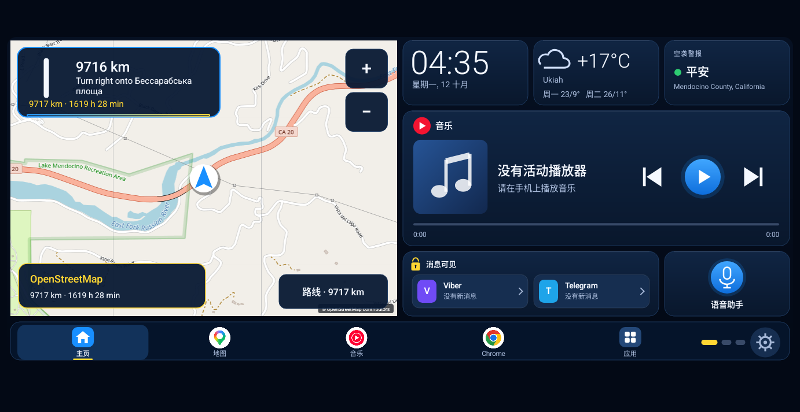

# XiaoDroidLink — 用户指南

语言：[English](README.md) · [Українська](README.ua.md) · [中文](README.zh.md) · [Français](README.fr.md) · [Español](README.es.md)

XiaoDroidLink 可以通过 CarLink 将 Android 手机连接到小米 YU7 车机屏幕。它可以在车机上显示仪表盘或手机屏幕，控制音乐，打开选定应用，把车机触摸操作传回手机，并通过屏幕投射显示 Google Maps。

这是一个独立项目，不是 Xiaomi、Samsung、ICCOA、Android Auto 或 Google 的官方产品。

## 功能

- 连接小米 YU7 CarLink。
- 输入车机屏幕上的 6 位验证码完成配对。
- 由小组件组成的主屏幕：最多三个屏幕、五种预设布局、23 个小组件（地图、下一个转弯、车速、测速摄像头、充电站、回家/公司路线、音乐、消息、联系人、日历、手机应用窗口等）。可在车机屏幕上排列、调整大小和设置：齿轮 → 小组件。
- 提供八种设计，每种都有地图、媒体和行程预览。底部的“屏幕 1/3 ›”按钮可切换三个实时屏幕，齿轮按钮可打开设计目录。
- 来电卡片，带“接听”和“拒接”按钮。
- 手机屏幕模式：在车机屏幕上显示手机应用。
- 通过 Android 无障碍服务把车机触摸操作传回手机。
- 媒体控制：播放/暂停、上一首、下一首。
- 通过手机屏幕投射在仪表盘中显示所选地图应用；默认使用 Google Maps。
- 当蓝牙音频不可用时，可通过 CarLink 传输音频。
- 可选择要显示在车机中的应用。
- 语音提醒：测速摄像头和空袭警报。
- 用你的语言使用车机助手：按方向盘按钮说出指令，手机用中文转告车辆。
- 支持语言：English、Українська、中文、Français、Español。

## 视频

英文演示（49 秒）：

[](https://www.youtube.com/shorts/3C1UO75dUE4)

每项功能和小组件的详细说明（英文）：[All features](FEATURES.md) · [Home screen widgets](WIDGETS.md)。

## 从 Google Play 安装

应用目前在 Google Play 进行封闭测试，需要先加入测试者群组。

1. 打开群组：[https://groups.google.com/g/xiaodroid-testers](https://groups.google.com/g/xiaodroid-testers)
2. 点按“加入群组”（使用手机上 Google Play 的同一个 Google 账号）。
3. 在 Google Play 打开 XiaoDroidLink：[https://play.google.com/store/apps/details?id=salon.lifestyle.xiaodroidlink](https://play.google.com/store/apps/details?id=salon.lifestyle.xiaodroidlink)
4. 点按“安装”。

如果 Google Play 提示找不到应用，说明你还没有加入群组，或登录的是其他账号。加入后可能需要几分钟才能生效。

之后更新会通过 Google Play 自动推送。两种方式不要混用：Google Play 版本和下面的 APK 签名不同，无法互相覆盖安装。

## 下载 APK

[下载 XiaoDroidLink-7.62.apk](https://github.com/vvkovtun/xiaodroidlink-releases/raw/main/XiaoDroidLink-7.62.apk)

## 截图

在手机应用中可通过“无车预览”查看仪表盘。

| 车机屏幕预览 |
|---|
|  |

| 第 2 屏（共 3 屏）：媒体 | 第 3 屏（共 3 屏）：行程 |
|---|---|
|  |  |

| 设计目录 |
|---|
|  |

| 主屏幕 | 权限 |
|---|---|
|  |  |

| 设置 |
|---|
|  |
## 安装

1. 下载 [XiaoDroidLink-7.62.apk](https://github.com/vvkovtun/xiaodroidlink-releases/raw/main/XiaoDroidLink-7.62.apk)。
2. 在手机上打开 APK 文件。
3. 如果 Android 要求允许从此来源安装，请允许。
4. 等待安装完成。
5. 打开 XiaoDroidLink。

如果安装 APK 后 Android 不允许启用无障碍服务，请打开：

```text
Settings -> Apps -> XiaoDroidLink -> three-dot menu -> Allow restricted settings
```

然后回到 XiaoDroidLink，再次打开权限页面。

## 首次设置

在 XiaoDroidLink 中打开 Permissions，并授予需要的权限：

- Bluetooth、location、microphone、notifications — 用于查找车辆、连接车机 Wi-Fi、音频和通知。
- Notification access — 用于音乐、Google Maps 提示和消息。
- Accessibility — 用于从车机屏幕控制手机应用。
- Modify system settings — 用于正确的屏幕方向。
- Unrestricted battery — 防止 Android 在后台中断连接。
- Screen casting — 用于 Google Maps 和手机屏幕模式。

## 连接车辆

1. 在小米 YU7 屏幕上打开 CarLink。
2. 在手机上打开 XiaoDroidLink。
3. 点击 Connect。
4. 如果 Android 请求屏幕投射权限，选择 Entire screen 并点击 Start。
5. 车机屏幕会显示 6 位验证码。
6. 在 XiaoDroidLink 中输入验证码。
7. 连接后选择 Dashboard 或 Phone screen 模式。
8. 行程结束后，在应用或通知中点击 Disconnect。

## 通过车辆蓝牙通话和语音

音乐通过 CarLink（Wi‑Fi）传到车上。通话、导航语音和 ChatGPT 走车辆蓝牙，需要单独连接。请在停车时操作。

1. 按上面的步骤连接车辆，等待车机屏幕出现画面。
2. 手机上会出现通知 `车辆蓝牙未连接`，点按它。
3. 应用会自动断开连接并打开蓝牙设置。在列表中选择你的车。
4. 不要再点其他东西。几秒钟后应用会自动重新连接，画面恢复。
5. 检查：通话或 ChatGPT 的声音应从车内扬声器播放。

需要了解：

- 不要在启动 CarLink 之前提前连接车辆蓝牙。CarLink 启动时车辆会断开这种连接。可靠的方式是通过通知操作。
- 如果蓝牙显示已连接，但通话仍从手机播放，请再次点按同一通知并重新选择车辆。
- 手机不会自动连接车辆蓝牙。每次行程开始时需要手动选择一次车辆。
- 选择车辆的时间为 90 秒。超时后应用会在没有蓝牙的情况下回到车机画面，通知会再次出现。
- 之后不要关闭车机屏幕上的 CarLink。只要它保持打开，蓝牙在断线和重新连接后仍会保持。如果关闭后重新打开，需要重复以上步骤。
- 蓝牙已连接时，音乐会在画面出现约 10 秒后才在车内播放。这是有意的延迟，避免车辆断开蓝牙。
- CarLink 运行时 YU7 不接受蓝牙音乐，因此 `通过 CarLink 播放音频` 必须保持开启。
- 已在 Xiaomi YU7 Max 上测试。车辆偶尔仍会断开蓝牙，此时重复第 2–4 步。

## 用你的语言使用车机助手

车机助手（超级小爱）只听得懂中文。XiaoDroidLink 为其他语言的用户转述：用户用自己的语言说出指令，手机**用自己的扬声器**以中文复述，车辆执行。可以控制空调、座椅、车窗、前备箱、雨刮、灯光和驾驶模式。

如果你会说中文，直接对车机助手说就行，不需要这个功能。应用语言为中文时，手机会把听到的中文原样转述。

### 开启

1. 手机上：XiaoDroidLink → 设置 → 打开 **“用你的语言使用车机助手”** 开关。
2. 如果手机询问，允许使用麦克风。
3. 手机需要中文语音合成（Samsung 和 Google 一般自带）。如果没有，车机屏幕会提示：设置 → 文字转语音 → 安装中文。

开关关闭时，方向盘语音按钮仍和以前一样打开手机 AI（在“麦克风按钮”中选择的 ChatGPT、Gemini 或系统助手）。

### 使用

1. 按下**方向盘上的语音按钮**（左侧滚轮）。车机助手被唤醒，手机同时开始聆听，车机屏幕显示“请说出要车辆做什么…”。
2. 用应用语言说出指令。
3. 约 3 秒后，手机用中文说出指令，车辆执行并用中文回答。如果手机没有识别出指令，车机屏幕显示“没听懂：…”。

说“人工智能”、“AI”、“ChatGPT”或“Gemini”可打开**手机 AI**：手机先让车机助手退出（“退出小爱”），再打开 AI。

**不用语音的按钮：**编辑 → 快捷操作 → 设置 → **“🗣 车机语音…”**，两页共 43 条指令（“→ 更多指令”）。点按添加到小组件，再点一次移除。点按小组件中的按钮后手机会响一声：此时按下方向盘语音按钮，2.5 秒后手机说出指令。

### 支持的指令

空调开/关；温度 16–32 度、调高、调低；座椅加热、通风、按摩；方向盘加热；后窗除霜；后视镜加热、折叠、展开；车窗开 ✓ / 关 ✓；打开前备箱 ✓；后备箱开/关；充电口开/关；悬挂升高/降低；雨刮 ✓、雨刮快一点、雨刮洗涤；近光灯；后雾灯；阅读灯；氛围灯、调亮；雪地模式；运动模式；舒适模式；能量回收标准/强；音乐音量大一点/小一点；导航静音；中控屏、仪表屏调亮。询问电量和续航（如“电量多少”）时，手机会听取车辆的回答，并在屏幕上以应用语言显示数字。

座椅、车窗、温度和阅读灯可加“驾驶员”或“乘客”（转述为“主驾”“副驾”）。氛围灯可换颜色：红、橙、黄、绿、青、蓝、紫、粉、白。

✓ 表示已在车上验证。其余指令来自 YU7 自带的“语音技能”菜单，应同样有效，但尚未逐条测试。是否执行由车辆决定：部分操作可能只在驻车时允许。

### 限制

- 必须使用**方向盘按钮**。手机无法用“小爱同学”唤醒车机助手：车机只会短暂闪烁，不继续聆听（所有语音唤醒设置都试过）。
- 手机需放在**车内**（充电座或支架上），不要放在口袋或包里：车辆需要听到手机扬声器的声音。
- **前备箱只能用语音打开，不能关闭**：车辆不允许。

## 建议设置

- 使用 Google Maps 或手机屏幕模式时保持手机解锁。
- 如果需要仪表盘地图，打开 Google Maps in the dashboard。可在 Dashboard map app 中选择 Waze 或其他已安装地图应用。
- 只有当车辆无法接收蓝牙音频时，才打开 Audio through CarLink。
- 在 Apps in the car 中添加需要的应用。
- 第一次成功连接后，可以保持 Auto-connect 开启。

## 常见问题

手机和车机屏幕上全部提示的完整列表及设置截图（英文）：[屏幕错误与解决方法](TROUBLESHOOTING.md)。

### 找不到车辆

- 先在车机屏幕上打开 CarLink。
- 关闭车机上的 CarLink，然后重新打开。
- 在手机上关闭并重新打开 Bluetooth。
- 确认已授予 location 权限。
- 将手机靠近车辆。

### 验证码不被接受

- 输入车机屏幕上最新的验证码。
- 如果验证码已变化，请输入新的验证码。
- 关闭并重新打开车机上的 CarLink。
- 点击 Disconnect，然后重新开始。

### 车辆 Wi-Fi 无法连接

- 连接过程中保持车机上的 CarLink 打开。
- 关闭 VPN，或把 XiaoDroidLink 加入 VPN 例外。
- 在手机上关闭并重新打开 Wi-Fi。
- 如果手机连接到旧网络，请忘记旧的车辆 Wi-Fi 网络。

### 屏幕投射无法开始

- Android 请求权限时选择 Entire screen。
- 保持手机解锁。
- 确认 XiaoDroidLink 没有电池限制。
- 关闭并重新打开应用。

### 车机触摸无效

- 在 Android 无障碍设置中启用 XiaoDroidLink。
- 如果 Android 阻止此选项，请在应用信息页面允许 restricted settings。
- 启用无障碍后断开连接并重新连接。

### 音乐控制无效

- 授予 XiaoDroidLink notification access。
- 在手机上开始播放音乐。
- 检查 Music button player 设置。
- 授予通知权限后重新打开 XiaoDroidLink。

### 声音仍从手机播放

- 将手机连接到车辆蓝牙。
- 如果蓝牙音频不可用，打开 Audio through CarLink。
- 更改音频设置后断开并重新连接。

### 地图不显示

- 打开 Google Maps in the dashboard。
- 允许屏幕投射。
- 保持手机解锁。
- 在手机上启动所选地图应用的导航。

### 后台连接中断

- 关闭 XiaoDroidLink 的电池限制。
- 不要强制关闭应用。
- 保持活动连接通知。
- 如果手机有自带电池管理器，把 XiaoDroidLink 加入白名单。

## 诊断日志

应用内：

```text
Diagnostics -> Show log
```

手机文件：

```text
Android/data/salon.lifestyle.xiaodroidlink/files/probe.log
```

## Support

支持：xiaodroidlink@lifestyle.salon
