# XiaoDroidLink — ошибки на экране и что с ними делать

Языки: [English](TROUBLESHOOTING.md) · [Українська](TROUBLESHOOTING.ua.md) · [Русский](TROUBLESHOOTING.ru.md)

Здесь собраны все сообщения, которые приложение показывает на телефоне и на экране машины, и что делать с каждым. Найдите свой текст поиском по странице (Ctrl+F) или в оглавлении.

- [Где приложение показывает ошибки](#где-приложение-показывает-ошибки)
- [Красная карточка «Не работает»](#красная-карточка-не-работает)
  - [Касания и запуск программ не работают](#касания-и-запуск-программ-не-работают)
  - [Музыка и уведомления не работают](#музыка-и-уведомления-не-работают)
  - [Карта и экран телефона не показываются](#карта-и-экран-телефона-не-показываются)
  - [Музыка не идёт в машину](#музыка-не-идёт-в-машину)
  - [Машину не найти и не подключить](#машину-не-найти-и-не-подключить)
- [Ошибки во время подключения](#ошибки-во-время-подключения)
- [Сообщения на панели в машине](#сообщения-на-панели-в-машине)
- [Встроенная навигация](#встроенная-навигация)
- [Подключение обрывается](#подключение-обрывается)
- [Если ничего не помогло](#если-ничего-не-помогло)

Снимки сделаны на «чистом» Android 16 с украинским интерфейсом приложения. На Samsung, Xiaomi и других телефонах пункты системных настроек называются немного иначе — у каждого шага указано, где искать на Samsung.

## Где приложение показывает ошибки

| На телефоне | На экране машины |
|---|---|
| 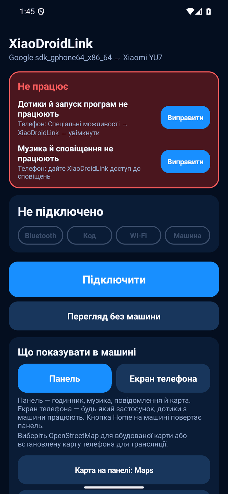 | 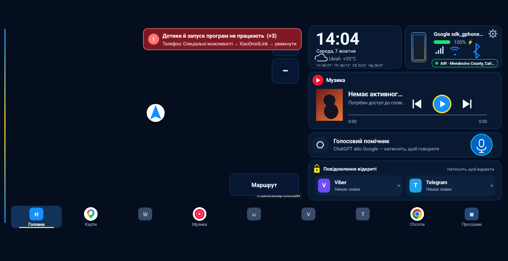 |

1. **Красная карточка «Не работает»** вверху главного экрана на телефоне. В каждой строке написано, что именно не работает, и есть кнопка `Исправить` — она открывает нужную настройку.
2. **Красная строка со знаком «!»** на панели в машине. Это та же проблема, что и на телефоне. `(+3)` в конце значит, что есть ещё три проблемы — строка показывает их по одной, пока не исправите все. С экрана машины это не исправить: нужен телефон.
3. **Строка под названием этапа** на телефоне (`Ищу машину…`, `Ошибка`) — что происходит с подключением прямо сейчас.

Карточка и красная строка исчезают сами, как только причина устранена. Перезапускать приложение не нужно.

## Красная карточка «Не работает»

### Касания и запуск программ не работают

> Телефон: Специальные возможности → XiaoDroidLink → включить

Нажатия на экране машины не доходят до телефона, а программы из дока не открываются. Выключена служба специальных возможностей.

1. Нажмите `Исправить` рядом с этой строкой, прочитайте пояснение и нажмите `Согласен`.
2. В списке найдите **XiaoDroidLink: car touch controls** (раздел «Загруженные приложения» / «Установленные приложения»).
3. Включите переключатель и подтвердите кнопкой `Разрешить`.

| 1. Согласиться | 2. Найти службу | 3. Включить | 4. Разрешить |
|---|---|---|---|
| 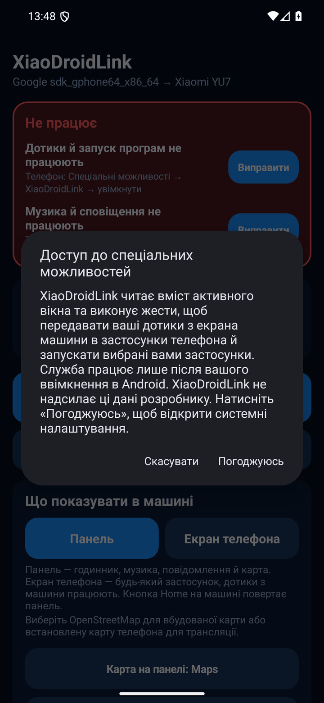 | 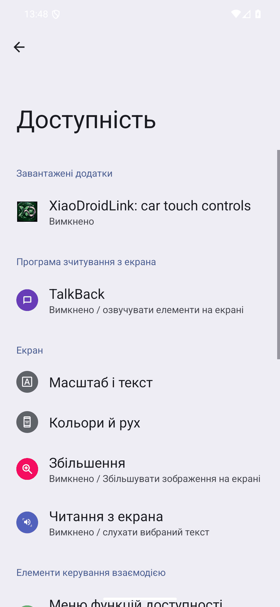 | 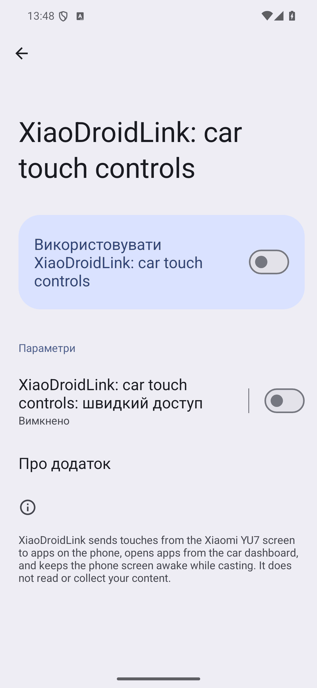 | 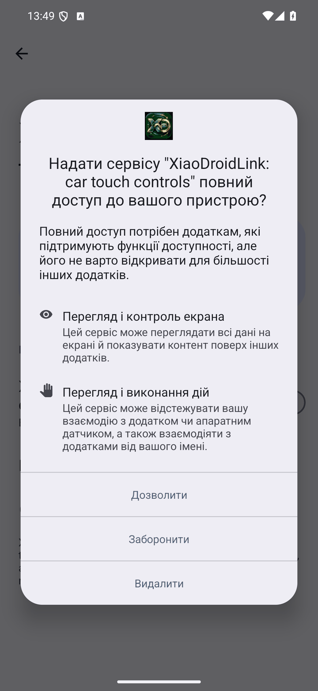 |

Samsung: `Настройки → Специальные возможности → Установленные приложения → XiaoDroidLink: car touch controls`.

**Переключатель серый или Android пишет «Ограниченная настройка».** Так бывает, когда приложение установлено из APK-файла, а не из магазина:

```text
Настройки → Приложения → XiaoDroidLink → ⋮ (три точки вверху справа) → Разрешить ограниченные настройки
```

Если трёх точек нет — сначала попробуйте включить переключатель, получите отказ и вернитесь на эту страницу: пункт появляется только после первого отказа.

**Служба сама выключается.** Android выключает её после обновления приложения и иногда после принудительного закрытия. Включите ещё раз и снимите ограничение батареи (раздел `Разрешения` → `Без ограничения батареи`).

### Музыка и уведомления не работают

> Телефон: дайте XiaoDroidLink доступ к уведомлениям

На панели нет названия трека, не работают кнопки плеера, не видно сообщений и подсказок Google Maps. В блоке музыки при этом написано `Музыка не играет` / `Требуется доступ к уведомлениям`.

1. Нажмите `Исправить`.
2. В списке выберите **XiaoDroidLink**.
3. Включите доступ к уведомлениям и подтвердите.

| 1. Выбрать XiaoDroidLink | 2. Включить доступ |
|---|---|
| 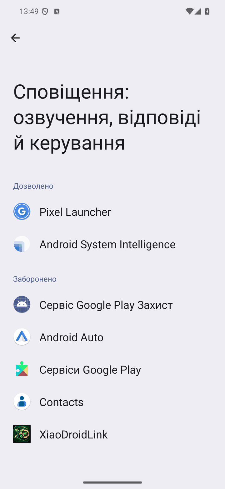 | 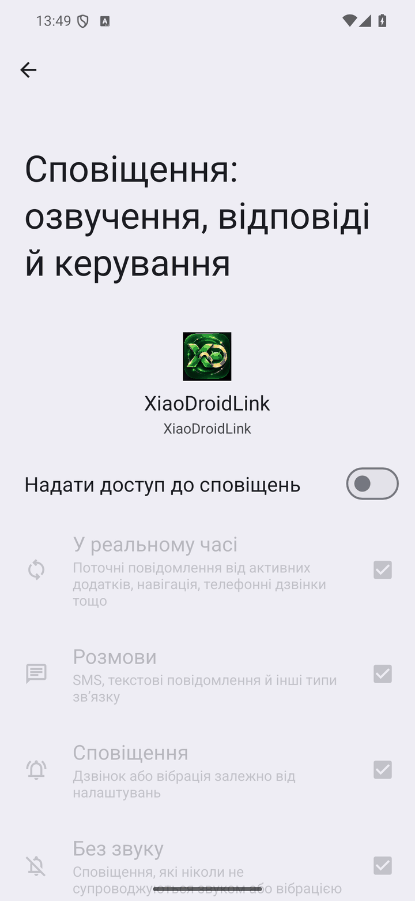 |

Samsung: `Настройки → Уведомления → Дополнительные параметры → Доступ к уведомлениям`.

Если переключатель серый — это та же «Ограниченная настройка», см. выше.

### Карта и экран телефона не показываются

> Откройте XiaoDroidLink на телефоне и разрешите трансляцию экрана

Машина показывает панель, но вместо Google Maps или экрана телефона — надпись `Нет разрешения на трансляцию экрана телефона` или `Нет трансляции экрана телефона`. Android спрашивает разрешение на трансляцию **при каждом подключении**, и запомнить его нельзя.

1. Откройте XiaoDroidLink на телефоне (или нажмите уведомление `Включить карту и звук в машине`).
2. В окне Android оставьте «весь экран» и подтвердите трансляцию (на старых версиях — `Весь экран` → `Начать`).

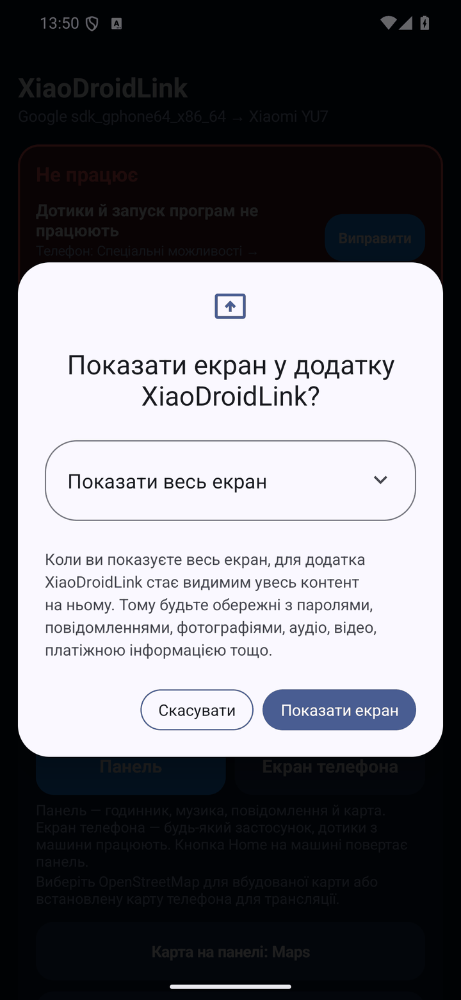

- Если выбрать «Одно приложение» — машина покажет только его, а панель карты останется пустой.
- Если нажали `Отмена` — приложение работает дальше как панель со встроенной картой OpenStreetMap. Окно можно вызвать снова: `Разрешения` → `Трансляция экрана` → `Предоставить`.
- После автоподключения разрешения ещё нет — на телефоне появляется уведомление, его нужно нажать.

### Музыка не идёт в машину

Машина показывает картинку, но звук играет из телефона. Подсказка под заголовком говорит, какой именно случай:

| Подсказка | Что сделать |
|---|---|
| `Телефон: включите «Звук через CarLink» в XiaoDroidLink` | Нажмите `Исправить` или включите `Настройки` → `Звук через CarLink`. |
| `Телефон: разрешите трансляцию экрана — без нее звук не передается` | Звук через CarLink идёт вместе с трансляцией экрана. Нажмите `Исправить` и разрешите трансляцию, как в предыдущем разделе. |

**Spotify и SoundCloud в машине не играют.** Они не позволяют другим программам брать свой звук, а музыку по Bluetooth YU7 не принимает. Поэтому XiaoDroidLink не показывает их среди плееров. Проверено, что звук идёт из YouTube Music, Deezer, Samsung Music и VLC.

Через CarLink передаётся только музыка. Голос навигации, ChatGPT и звонки идут через Bluetooth машины — если видите уведомление `Bluetooth машины не подключен`, нажмите на него и выберите машину в списке Bluetooth. Приложение на это время само разорвёт соединение (пока CarLink работает, YU7 не принимает Bluetooth) и само подключится снова, как только Bluetooth подключится. Не подключайте Bluetooth машины заранее, до запуска CarLink: машина такое соединение сбрасывает, когда CarLink стартует. После подключения через уведомление не закрывайте CarLink на экране машины — тогда Bluetooth держится и при следующих подключениях. Подробно: раздел о звонках и голосе через Bluetooth машины в инструкции.

### Машину не найти и не подключить

> Предоставьте Bluetooth, геолокацию, микрофон и уведомления

Не предоставлены основные разрешения. Нажмите `Исправить` и соглашайтесь в каждом окне. Геолокация нужна, потому что без неё Android не позволяет искать Bluetooth-устройства и сети Wi‑Fi.

Если окна уже не появляются (вы раньше отказали дважды):

```text
Настройки → Приложения → XiaoDroidLink → Разрешения → разрешить «Устройства поблизости», «Местоположение», «Микрофон», «Уведомления»
```

## Ошибки во время подключения

Текст появляется под названием этапа на главном экране. Четыре отметки `Bluetooth · Код · Wi‑Fi · Машина` показывают, до какого шага дошло подключение.

| Bluetooth отключен | Машина не видна |
|---|---|
| 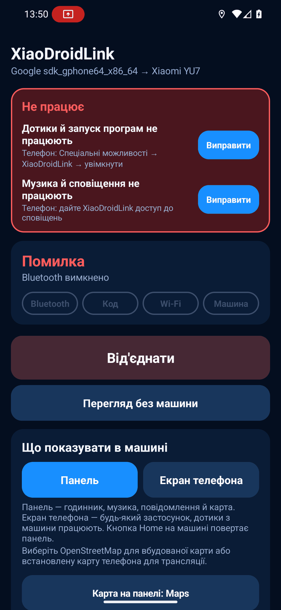 | 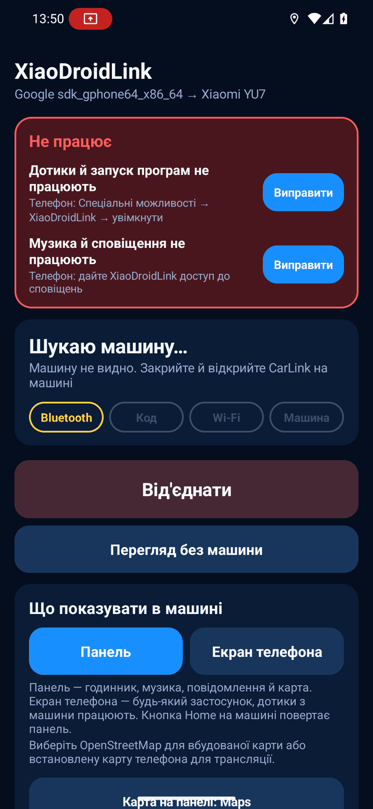 |

### Этап «Bluetooth»

| Сообщение | Что это значит | Что сделать |
|---|---|---|
| `Сначала разрешите Bluetooth и геолокацию` | Нет основных разрешений. | Согласитесь в окнах Android и нажмите `Подключить` ещё раз. |
| `Bluetooth отключен` | На телефоне выключен Bluetooth. | Включите Bluetooth, нажмите `Отключить`, потом `Подключить`. |
| `Включите CarLink на экране машины` | Приложение ищет машину. Это не ошибка. | Откройте CarLink на экране машины и подождите до полуминуты. |
| `Машина не видна. Закройте и откройте CarLink на машине` | За 30 секунд машина не откликнулась. | Закройте CarLink на машине и откройте снова. Поднесите телефон ближе. Выключите и включите Bluetooth на телефоне. Проверьте, что включена геолокация телефона (не только разрешение, но и сам переключатель в шторке). |
| `Ошибка Bluetooth-поиска (число)` | Android не смог начать поиск. | Выключите и включите Bluetooth. Если повторяется — перезагрузите телефон. |
| `Машина не отвечает по Bluetooth` | Машина найдена, но соединиться не удалось. | Закройте и откройте CarLink на машине, затем `Отключить` → `Подключить`. |
| `Машина не отвечает как CarLink` | Найденное устройство не отвечает по протоколу CarLink. | Убедитесь, что на экране машины открыт именно CarLink, а не другой способ подключения. Откройте его заново. |
| `Bluetooth-соединение потеряно` | Связь пропала, приложение переподключается само. | Подождите. Если не восстановилось — `Отключить` → `Подключить`. |

### Этап «Код»

| Сообщение | Что это значит | Что сделать |
|---|---|---|
| `Введите код с экрана машины` | Машина показывает 6 цифр. | Введите их в приложении или прямо в уведомлении `Машина показывает 6 цифр`. |
| `Код имеет 6 цифр` | Введено меньше или больше цифр. | Введите ровно шесть. |
| `Код не принят. Введите новый код из машины` | Код устарел или с ошибкой. | Машина уже показывает новый код — введите его. |
| `Требуется код с экрана машины` | Машина не пустила без кода (например, забыла телефон). | Введите код с экрана. |
| `Не удалось отправить код, попробуйте снова` | Bluetooth-связь прервалась в момент отправки. | Нажмите `Отправить код` ещё раз. |
| `Машина просит код — подключаюсь заново` | Автоподключение без кода не сработало. | Ничего, подождите: приложение само начнёт заново и попросит код. |
| `Вход без кода` | Машина узнала телефон. Это не ошибка. | — |

Если код на машине не появляется вообще — закройте CarLink на машине, откройте снова и нажмите `Подключить` на телефоне.

### Этап «Wi‑Fi»

| Сообщение | Что это значит | Что сделать |
|---|---|---|
| `Внимание: включенный VPN может мешать подключению к машине` | Предупреждение до подключения. | Выключите VPN или добавьте XiaoDroidLink в его исключения (split tunneling). |
| `Включенный VPN блокирует соединение с машиной. Выключите VPN или добавьте XiaoDroidLink в его исключение` | VPN забрал себе сеть машины. | То же самое. После этого `Отключить` → `Подключить`. Проверьте также «постоянный VPN» и частный DNS/блокировщики рекламы, которые работают как VPN. |
| `Wi‑Fi машины не видно, попытка 1 из 3` | Телефон не видит сеть машины, приложение пробует ещё. | Не закрывайте CarLink на машине. Подождите. |
| `Не удалось подключиться к Wi‑Fi машине` | Три попытки подряд неудачны. | Выключите и включите Wi‑Fi на телефоне. Если Android показывает окно «Подключиться к устройству?» — согласитесь. Закройте и откройте CarLink на машине. В настройках Wi‑Fi телефона «забудьте» старые сети машины. |
| `Wi‑Fi машины исчез` | Сеть пропала во время работы, приложение переподключается. | Подождите. Если повторяется — выключите на телефоне «умное» переключение Wi‑Fi на мобильные данные. |

#### Wi‑Fi машины не видно в некоторых странах (Беларусь)

Машины с CarLink (Xiaomi YU7, Jetta VS8, Toyota bZ3X, Lynk & Co 08 и другие) всегда поднимают свою сеть на 5 ГГц,
канал 149 (5745 МГц). Изменить частоту с телефона нельзя — машина игнорирует запрос (проверено на YU7).

Телефон берёт страну из мобильной сети (SIM-карта и вышка) и включает только те частоты, что разрешены в этой стране.
В Беларуси диапазон 5725–5850 МГц (каналы 149–165) не разрешён, поэтому телефон с белорусской мобильной сетью
просто не видит Wi‑Fi машины. В России, Украине, Польше и ЕС этот диапазон разрешён — там та же машина работает.
Так же бывает, если прошивка телефона привязана к региону с такими ограничениями.

**Что сделать (проверено пользователем в Беларуси, 09.11.2026):**

1. Включите режим полёта.
2. Перезагрузите телефон, режим полёта не выключайте.
3. Включите Wi‑Fi и Bluetooth (режим полёта остаётся).
4. Откройте CarLink на машине и нажмите `Подключить`.

Без мобильной сети телефон не знает страны и не включает ограничения. Без перезагрузки он помнит последнюю страну,
поэтому шаг 2 обязателен. Когда машина уже показывает трансляцию, режим полёта можно выключить — соединение с машиной
держится до выхода из машины, а мобильный интернет и звонки возвращаются (проверено пользователем 09.11.2026).
После каждого выхода из машины для следующего подключения порядок нужно повторить сначала — пока вы в такой стране; после выезда всё работает как обычно.

Владельцам Samsung помогает ещё смена региона прошивки (CSC) на европейский, например XXV, но ненадолго:
после режима полёта телефон снова берёт страну из мобильной сети.

По опыту пользователей, на телефонах Xiaomi с root помогает смена региона Wi‑Fi на страну, где канал 149 разрешён (например, европейскую).
Это та же проблема, что и у Xiaomi Interconnectivity: машина и телефон соединяются напрямую по Wi‑Fi на том же канале.

### Этап «Машина»

| Сообщение | Что это значит | Что сделать |
|---|---|---|
| `Машина не начала трансляцию. Нажмите «Подключить» еще раз` | Телефон в сети машины, но машина не запросила картинку. | `Отключить` → `Подключить`. Если дважды подряд — закройте и откройте CarLink на машине. |
| `Машина завершила трансляцию` | Машина закрыла CarLink (выключено зажигание, открыт другой экран). | Откройте CarLink на машине; с включённым `Автоподключение` телефон подключится сам. |
| `Связь потеряна, переподключаюсь…` | Приложение восстанавливает связь. | Подождите 10–20 секунд. |
| `Без трансляции экрана: только панель, без карты Google` | Вы отменили окно трансляции. | См. [Карта и экран телефона не показываются](#карта-и-экран-телефона-не-показываются). |

## Сообщения на панели в машине

### В блоке карты и экрана телефона

| Сообщение | Что сделать |
|---|---|
| `Нет разрешения на трансляцию экрана телефона` · `Нет трансляции экрана телефона` · `Карта недоступна без трансляции экрана` | Разрешите трансляцию на телефоне — см. [выше](#карта-и-экран-телефона-не-показываются). |
| `Разблокируйте телефон для просмотра карты` · `Телефон заблокирован` | Разблокируйте телефон. Android не транслирует заблокированный экран. Экран телефона притемняется сам, блокировать его не нужно. С [дополнительными функциями](EXTRAS_ADB.ru.md) музыка и соединение остаются, пока телефон заблокирован. |
| `Телефон в руках — коснитесь экрана, чтобы вернуть карту` | Вы взяли телефон и пользуетесь им — машина временно не показывает его экран. Коснитесь экрана машины. |
| `Ожидаю изображение с телефона…` · `Открываю Google Maps…` | Подождите несколько секунд. Если не проходит — нажмите `Главная`, потом `Карты` ещё раз. |
| `Загружаю карту OpenStreetMap…` | Встроенной карте нужен интернет на телефоне для новых участков. |
| `Включите «Google Maps на панели» в приложении на телефоне` | На телефоне: `Карта на панели` → выберите Google Maps, Waze или другую карту. |

### Короткие сообщения внизу экрана

| Сообщение | Что сделать |
|---|---|
| `… открыт на телефоне (нет разрешения на трансляцию)` | Программа открылась, но машина не может её показать. Разрешите трансляцию экрана. |
| `…: касание отключено (спец. возможности)` | Программу видно, но нажатия не работают. См. [Касания и запуск программ не работают](#касания-и-запуск-программ-не-работают). |
| `… не установлен на телефоне` | Установите программу или уберите её из `Программы в машине`. |
| `Не удалось открыть …` | Откройте программу один раз на телефоне вручную (некоторые требуют входа), потом попробуйте снова. |
| `Плеер недоступен` · `Нет музыкального приложения` | Запустите музыку на телефоне один раз. Проверьте `Плеер кнопки «Музыка»` в настройках и доступ к уведомлениям. |
| `Музыка не играет` · `Нажмите ▶` | Ничего не играет. Нажмите ▶ — заиграет плеер, выбранный кнопкой с его названием вверху блока музыки. |
| `Голосовой помощник недоступен` | Установите ChatGPT или выберите помощника: `Настройки Android → Приложения → Приложения по умолчанию → Цифровой помощник`. Проверьте поле `Кнопка микрофона`. |
| `Не удалось открыть сообщение` | Мессенджер не дал открыть чат. Откройте его на телефоне. |
| `Не удалось открыть настройки` | Откройте XiaoDroidLink на телефоне вручную. |

### Блок безопасности поездки

| Сообщение | Что это значит |
|---|---|
| `Статус временно недоступен` | Сервис воздушных тревог не ответил. Нужен интернет; приложение попробует снова само. |
| `База камер ожидает координаты` · `База камер недоступна` | Нет GPS-позиции или интернета для загрузки камер. На подключение это не влияет. |

## Встроенная навигация

| Сообщение | Что сделать |
|---|---|
| `Введите не менее 3 символов` | Введите более длинный запрос. |
| `Адрес не найден` | Введите город, улицу и номер дома полностью; попробуйте без номера. |
| `Не удалось выполнить поиск адреса: …` | Нет интернета или сервис поиска занят. Попробуйте через минуту. |
| `Нет актуальной геопозиции` · `Ожидаю геопозицию…` | Включите геолокацию на телефоне и подождите под открытым небом. |
| `Маршрут не найден` · `Не удалось построить маршрут: …` | Выберите другой адрес из списка или повторите позже — публичный сервер маршрутов бывает недоступен. |
| `Не удалось перепроложить; веду по старому маршруту` | Новый маршрут не загрузился, старый остаётся на экране. Приложение попробует ещё раз само. |
| `Требуемый адрес: https://` | В настройках сервера навигации укажите адрес, начинающийся с `https://`. |

## Подключение обрывается

- `Разрешения` → `Без ограничения батареи` → `Предоставить`. Samsung: `Настройки → Приложения → XiaoDroidLink → Батарея → Без ограничений`; также уберите приложение из списков «Спящие приложения».
- Не смахивайте XiaoDroidLink из списка недавних программ и не убирайте его уведомление `Соединение с машиной`.
- Выключите VPN.
- Музыка пропадает и машина переподключается каждый раз, когда вы блокируете телефон кнопкой: Android при блокировке останавливает трансляцию. Не блокируйте — телефон притемняется сам. Или один раз [настройте дополнительные функции нашим помощником](EXTRAS_ADB.ru.md): тогда блокировка не останавливает музыку и соединение.
- Если после обрыва пропали касания — проверьте, не выключил ли Android службу специальных возможностей (красная карточка подскажет).

## Если ничего не помогло

1. `Отключить` на телефоне.
2. Закройте CarLink на экране машины и откройте снова.
3. Выключите и включите Bluetooth и Wi‑Fi на телефоне.
4. `Подключить`.

Если ошибка осталась — отправьте лог на xiaodroidlink@lifestyle.salon. Сразу после ошибки откройте в приложении `Диагностика` → `Показать лог` и сделайте снимок экрана, или возьмите файл:

```text
Android/data/salon.lifestyle.xiaodroidlink/files/probe.log
```

В письме напишите модель телефона, версию Android, версию XiaoDroidLink и точный текст ошибки с экрана.
