# XiaoDroidLink — Guía de usuario

Idiomas: [English](../README.md) · [Українська](README.ua.md) · [中文](README.zh.md) · [Français](README.fr.md) · [Español](README.es.md) · [Deutsch](README.de.md) · [Polski](README.pl.md) · [Қазақша](README.kk.md) · [Azərbaycanca](README.az.md) · [Oʻzbekcha](README.uz.md) · [Тоҷикӣ](README.tg.md) · [ქართული](README.ka.md) · [Հայերեն](README.hy.md) · [Кыргызча](README.ky.md) · [Русский](README.ru.md)

XiaoDroidLink conecta un teléfono Android a la pantalla del Xiaomi YU7 mediante CarLink. La aplicación puede mostrar un panel o la pantalla del teléfono en el coche, controlar la música, abrir apps seleccionadas, enviar los toques de la pantalla del coche al teléfono y usar Google Maps mediante transmisión de pantalla.

**Funciona con coches con CarLink (ICCOA).** Los usuarios ya han confirmado que funciona con Xiaomi (YU7, SU7), Toyota (RAV4, Camry 80), Nissan (X-Trail T32), Haval (Xiaolong Max), Deepal (S05), GAC (Aion Y Plus), Wuling (Starlight 730), Lynk & Co (08) y Jetta (VS8). ¿Otro coche con CarLink? Pruébalo y envía un informe desde la app: lo resolveremos.

Este es un proyecto independiente. No es un producto oficial de Xiaomi, Samsung, ICCOA, Android Auto ni Google.

## Funciones

- Conexión CarLink con Xiaomi YU7.
- Emparejamiento con código de 6 dígitos mostrado en la pantalla del coche.
- Pantalla de inicio hecha de widgets: hasta tres pantallas, cinco diseños listos, 23 widgets (mapa, próximo giro, velocidad, radares, cargadores, rutas Casa/Trabajo, música, mensajes, contactos, calendario, ventana de una app del teléfono y más). Ordénelos, cambie su tamaño y ajústelos en la pantalla del coche: engranaje → Widgets.
- Ocho estilos con vistas de mapa, multimedia y viaje. El botón Pantallas 1/3 › del dock cambia entre las tres pantallas; el engranaje abre el catálogo de estilos.
- Tarjeta de llamada entrante con los botones Responder y Rechazar.
- Modo pantalla del teléfono: muestra apps del teléfono en la pantalla del coche.
- Control táctil desde la pantalla del coche mediante Accesibilidad de Android.
- Controles multimedia: reproducir/pausar, pista anterior, pista siguiente.
- App de mapa seleccionada en el panel mediante transmisión de pantalla del teléfono; Google Maps es el valor predeterminado.
- Audio por CarLink cuando el audio Bluetooth no funciona.
- Selector de apps para mostrar en el coche.
- Avisos de voz para radares y alertas aéreas — en el reposacabezas del conductor, en el idioma de la app (en inglés si el teléfono no tiene voz para él). Los radares se cargan para todo el país donde estás, también en el extranjero.
- Asistente del coche en tu idioma: botón del volante, una orden, y el teléfono se la dice al coche en chino.
- Idiomas (15): English, Українська, 中文, Français, Español, Deutsch, Polski, Қазақша, Azərbaycanca, Oʻzbekcha, Тоҷикӣ, ქართული, Հայերեն, Кыргызча, Русский.

## Vídeos

Presentación en inglés (49 s):

[](https://www.youtube.com/shorts/3C1UO75dUE4)

Cada función y widget en detalle (en inglés): [All features](../docs/FEATURES.md) · [Home screen widgets](../docs/WIDGETS.md).

## Instalar desde Google Play

XiaoDroidLink está en Google Play.

1. Abre XiaoDroidLink en Google Play en el teléfono: [https://play.google.com/store/apps/details?id=salon.lifestyle.xiaodroidlink](https://play.google.com/store/apps/details?id=salon.lifestyle.xiaodroidlink)
2. Toca «Instalar».
3. Abre XiaoDroidLink.

Las actualizaciones llegan solas por Google Play.

Si antes instalaste XiaoDroidLink desde un archivo APK, desinstálalo primero: el APK y la versión de Google Play tienen firmas distintas, así que Google Play no puede instalar encima. Después de reinstalar, introduce de nuevo el código de la pantalla del coche.

## Qué teléfonos sirven

- Android 13 o posterior.
- Probado en el coche con un Samsung Galaxy S25 Ultra.
- Los teléfonos con un codificador de vídeo más débil (muchos MediaTek y Unisoc, p. ej. Infinix, Tecno, algunos Galaxy A) envían al coche una imagen algo más pequeña con las mismas proporciones. «Vista sin coche» funciona en ellos (comprobado en un Infinix Hot 40); en el coche aún no se ha probado. Si la imagen no ocupa toda la pantalla o no aparece, escribe a xiaodroidlink@lifestyle.salon.

## Capturas

La opción de vista previa sin coche permite ver el panel en el teléfono.

| Vista en la pantalla del coche |
|---|
| 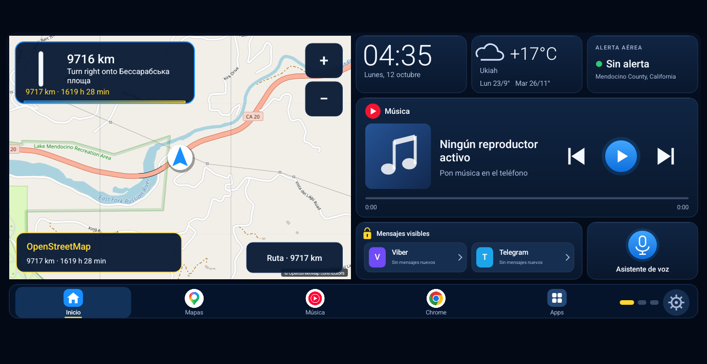 |

| Pantalla 2 de 3: multimedia | Pantalla 3 de 3: viaje |
|---|---|
| 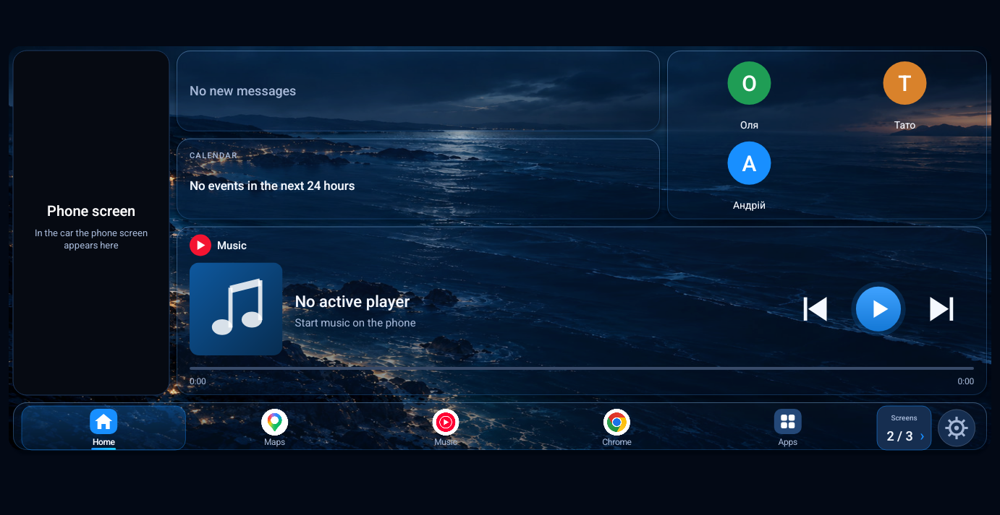 | 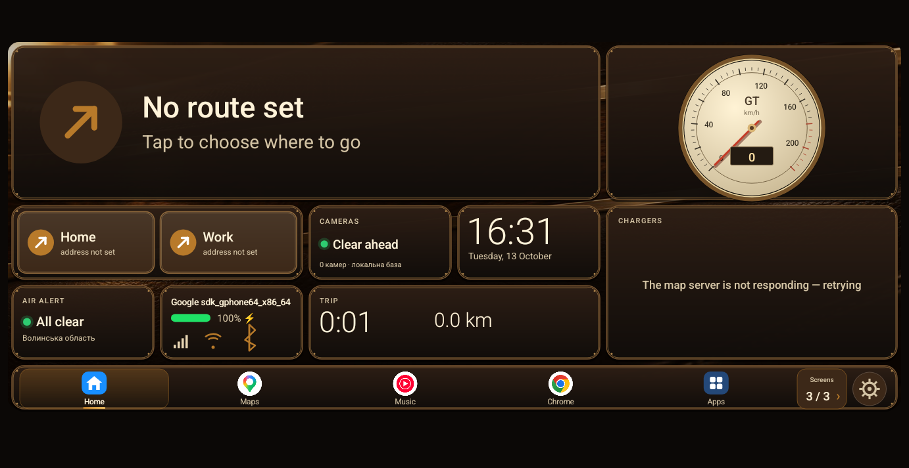 |

| Catálogo de diseños |
|---|
| 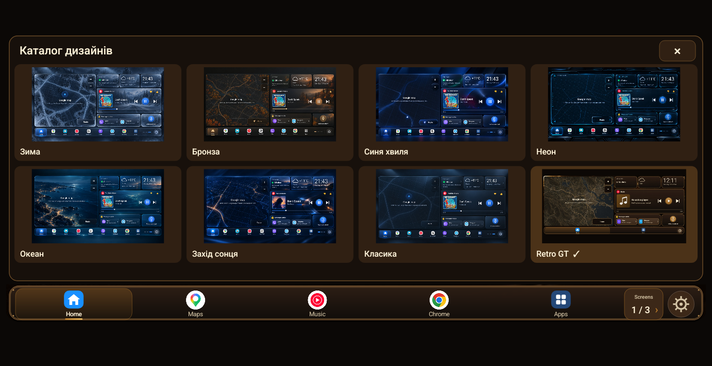 |

| Pantalla principal | Permisos |
|---|---|
| 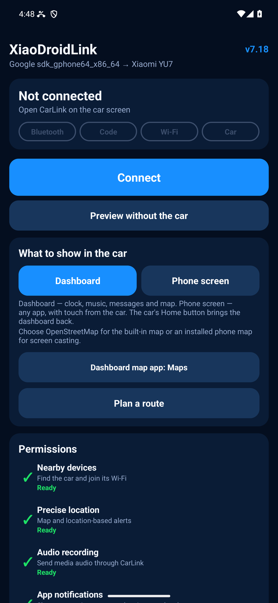 | 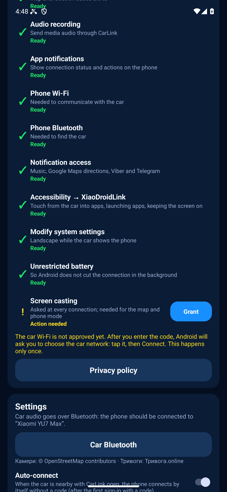 |

| Ajustes |
|---|
| 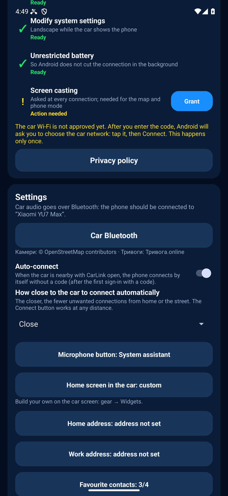 |

## Primera configuración

Tras instalarla, XiaoDroidLink te guía sola: arriba de la pantalla principal aparece una tarjeta naranja **«Configuración: paso 1 de 5»**. La tarjeta explica para qué es el permiso, y la línea bajo el botón dice qué pulsar. Pulsa el botón naranja **«Permitir»** y sigue la línea de debajo. Un paso se puede omitir («Omitir: lo haré después»): entonces la tarjeta se sustituye por una línea «Pasos omitidos» con el botón **«Configurar ahora»**. Cuando todo está concedido, la tarjeta desaparece.

| 1 | 2 | 3 |
|---|---|---|
| 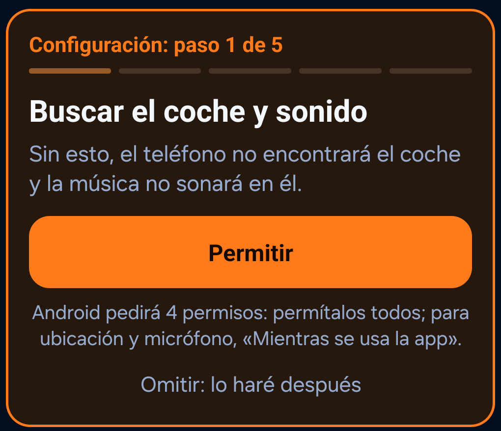 | 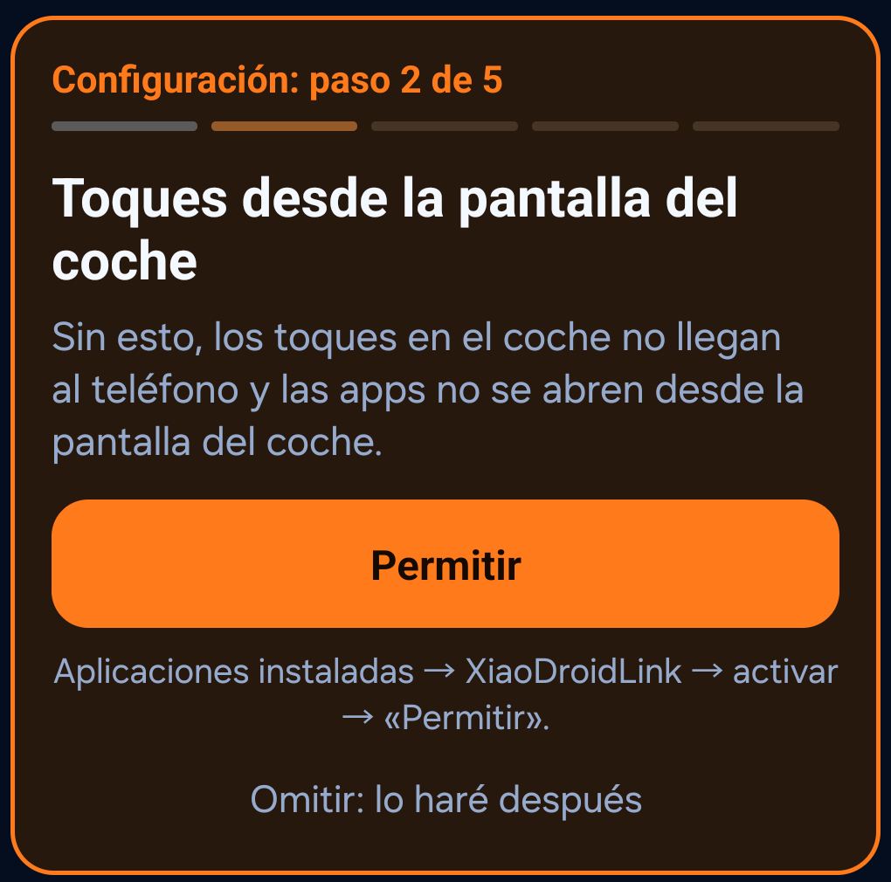 | 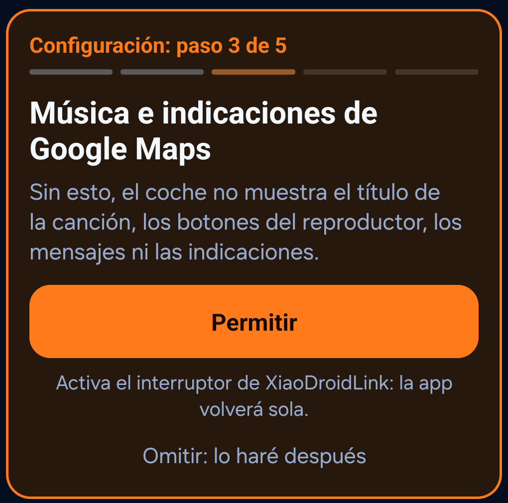 |

| 4 | 5 |
|---|---|
| 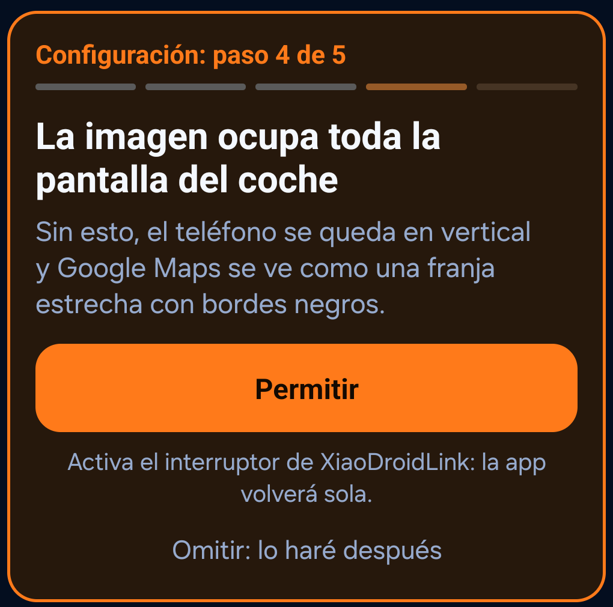 | 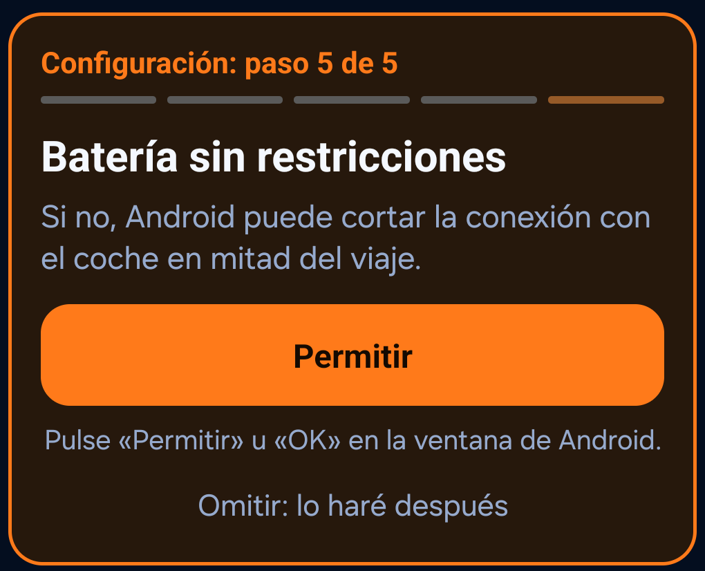 |

**Paso 1. Encontrar el coche y sonido.** Pulsa «Permitir». Android muestra 4 ventanas seguidas:

| Ventana de Android | Qué pulsar |
|---|---|
| Acceso a la ubicación | «Precisa» y luego «Mientras se usa la app» |
| Grabar audio (micrófono) | «Mientras se usa la app» |
| Dispositivos cercanos | «Permitir» |
| Enviar notificaciones | «Permitir» |

**Paso 2. Toques desde la pantalla del coche** (accesibilidad).
1. Pulsa «Permitir», lee la explicación y pulsa «Acepto». Se abre «Accesibilidad».
2. Abre la sección de apps descargadas: Samsung — **«Aplicaciones instaladas»**; Xiaomi, Redmi, POCO — **«Aplicaciones descargadas»**; otros teléfonos — «Descargadas» o «Aplicaciones instaladas».
3. Pulsa **«XiaoDroidLink: car touch controls»**.
4. Activa el **interruptor de arriba**.
5. Android pregunta si permitir el control total del dispositivo: pulsa **«Permitir»**.
6. Más abajo está el interruptor **«Acceso directo …»**: **déjalo apagado**, un toque accidental desactiva el control desde el coche.
7. Vuelve a XiaoDroidLink con Atrás.

**Paso 3. Música e indicaciones de Google Maps** (acceso a notificaciones). Pulsa «Permitir». Se abre la lista **«Acceso a notificaciones»**: pulsa **XiaoDroidLink** y confirma «Permitir». La app vuelve sola.

**Paso 4. Imagen en toda la pantalla del coche.** Pulsa «Permitir». Se abre la página **«Modificar ajustes del sistema»** de XiaoDroidLink: activa el **permiso**. La app vuelve sola.

**Paso 5. Sin restricción de batería.** Pulsa «Permitir». Android pregunta si dejar de optimizar la batería: pulsa **«OK»** en Samsung o **«Permitir»** en otros teléfonos.

En la primera conexión Android también pide transmitir la pantalla: elige **«Pantalla completa»** y pulsa **«Empezar»**.

Si un paso no funciona, la tarjeta tiene el botón «¿No lo consigue? Enviar informe al desarrollador»: ver [Enviar un informe o una sugerencia](#enviar-un-informe-o-una-sugerencia).

## Conectar al coche

1. Abre CarLink en la pantalla del Xiaomi YU7.
2. Abre XiaoDroidLink en el teléfono.
3. Toca Connect.
4. Si Android pide transmitir pantalla, elige Entire screen y toca Start.
5. La pantalla del coche mostrará un código de 6 dígitos.
6. Introduce ese código en XiaoDroidLink.
7. Después de conectar, elige Dashboard o Phone screen.
8. Al terminar el viaje, toca Disconnect en la app o en la notificación.

## Llamadas y voz por el Bluetooth del coche

La música llega al coche por CarLink (Wi‑Fi). Las llamadas, la voz de navegación y ChatGPT van por el Bluetooth del coche, que hay que conectar aparte. Hazlo con el coche parado.

1. Conéctate al coche como se explica arriba y espera a que aparezca la imagen en su pantalla.
2. En el teléfono aparece la notificación `El Bluetooth del coche no está conectado`. Tócala.
3. La aplicación detiene la conexión por sí sola y abre los ajustes de Bluetooth. Elige tu coche en la lista.
4. No toques nada más. En unos segundos la aplicación se conecta de nuevo y la imagen vuelve.
5. Comprueba: una llamada o la voz de ChatGPT debe sonar por los altavoces del coche.

Conviene saber:

- No conectes el Bluetooth del coche de antemano, antes de iniciar CarLink. El coche corta esa conexión cuando CarLink arranca. El camino fiable es el de la notificación.
- Si Bluetooth aparece como conectado pero las llamadas siguen sonando en el teléfono, toca la misma notificación y elige el coche otra vez.
- El teléfono no se conecta solo al Bluetooth del coche. Hay que elegir el coche a mano una vez al empezar el viaje.
- Tienes 90 segundos para elegir el coche. Si no llegas a tiempo, la aplicación vuelve a la pantalla del coche sin Bluetooth y la notificación aparece de nuevo.
- Después no cierres CarLink en la pantalla del coche. Mientras siga abierto, el Bluetooth aguanta cortes y nuevas conexiones. Si lo cierras y lo abres, repite los pasos.
- Con el Bluetooth conectado, la música empieza a sonar en el coche unos 10 segundos después de la imagen. El retraso es intencionado, para que el coche no corte el Bluetooth.
- El YU7 no acepta música por Bluetooth mientras CarLink funciona, así que `Sonido por CarLink` debe estar activado.
- Probado en el Xiaomi YU7 Max. De vez en cuando el coche corta el Bluetooth igualmente: repite los pasos 2–4.

## Comandos de voz de XiaoDroidLink — en cualquier coche

- 🎤 en el widget del mapa: di una dirección y empieza la ruta.
- 🎤 en la tarjeta de música: di una canción o un artista y empieza a sonar.

## Asistente del coche en tu idioma

**Solo coches Xiaomi.** En otros coches, el botón del volante abre el asistente propio del coche; los comandos que entiende dependen del modelo.

El asistente del coche (XiaoAI, 超级小爱) solo entiende chino. XiaoDroidLink traduce para él: dices una orden en tu idioma, el teléfono la repite en chino **por su propio altavoz** y el coche la ejecuta. Así puedes manejar el clima, los asientos, las ventanillas, el maletero delantero, los limpiaparabrisas, las luces y el tema de la pantalla.

Las órdenes se entienden en ucraniano, ruso, inglés, francés y español, y desde la 7.67 también en alemán, polaco, kazajo, azerí, uzbeko, tayiko, georgiano, armenio y kirguís. En estos nueve idiomas las órdenes están traducidas, pero aún no se han probado en el coche.

### Activar

1. Desde la 7.95 el asistente viene activado. Para apagarlo: en el teléfono, XiaoDroidLink → Ajustes → el interruptor **«Asistente del coche en tu idioma»**.
2. Permite el micrófono si el teléfono lo pide.
3. El teléfono necesita una voz china de texto a voz. Samsung y Google normalmente ya la tienen. Si no, el coche muestra una pista: Ajustes → Texto a voz → instala el chino.

Con el interruptor apagado, el botón del asistente en el volante abre como antes la IA del teléfono (ChatGPT, Gemini o el asistente del sistema elegido en «Botón de micrófono»).

### Usar

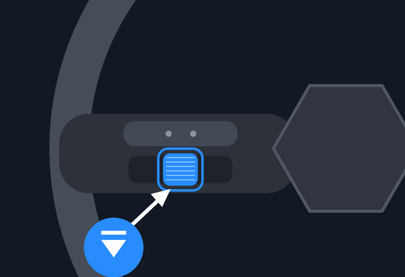

1. **Pulsa la rueda izquierda** del volante (púlsala, no la gires). El asistente del coche se despierta y el teléfono escucha a la vez. El coche muestra «Di qué debe hacer el coche…».
2. Di una orden, por ejemplo «abre el maletero delantero».
3. Unos 3 segundos después el teléfono la dice en chino, y el coche la ejecuta y responde (también en chino). Si el teléfono no reconoció la frase, el coche muestra «No entendí: …».

Para hablar con la **IA del teléfono**, pulsa el botón del volante y di «inteligencia artificial», «AI», «ChatGPT» o «Gemini». El teléfono pide al asistente del coche que salga («退出小爱») y abre la IA.

**Llamadas por voz:** pulsa el botón del volante y di «llama a Olena», «llama a mamá». El teléfono busca el nombre en sus contactos y llama; si hay varios, la pantalla del coche muestra hasta tres para elegir. La primera vez, permite en el teléfono el acceso a los contactos y a las llamadas. Si el Bluetooth del coche no está conectado, el teléfono no llama (la conversación iría a su altavoz): abre la elección del coche y te pide que vuelvas a llamar.

**La respuesta del coche en pantalla:** después de una orden, el teléfono escucha la respuesta en chino del coche y la muestra en la pantalla del coche en tu idioma (traducida por Google Translate, necesita internet).

**Lista de órdenes en pantalla:** pulsa el botón del volante y di «comandos»: la lista se abre en la pantalla del coche. O en el coche, engranaje → **«🗣 Órdenes del asistente»** (arriba en los ajustes); en el teléfono, el botón **«Órdenes del asistente»** bajo el interruptor «Asistente del coche en tu idioma». Solo aparecen las órdenes verificadas en el coche y lo que el coche no hace por voz.

### Qué puedes decir

Habla con normalidad. El teléfono busca qué quieres cambiar y si es encender o apagar («apaga», «cierra» significan apagar).

| Qué | Ejemplos |
|---|---|
| Temperatura | «más calor», «más frío», «temperatura 22», «enciende el aire», «apaga el aire» |
| Asientos | «calefacción del asiento», «apaga la calefacción del asiento», «asiento ventilado», «apaga la ventilación», «masaje» |
| Volante, cristales, retrovisores | «volante calefactado», «desempañado trasero», «desempañado del parabrisas», «retrovisores calefactados» |
| Ventanillas | «abre las ventanillas», «cierra las ventanillas», «abre las ventanillas a medias», «abre un poco las ventanillas» |
| Maleteros | «abre el maletero delantero» (o «capó»), «cierra el maletero delantero», «abre el maletero», «cierra el maletero» |
| Puerto de carga | «abre el puerto de carga», «cierra el puerto de carga» |
| Retrovisores | «pliega los retrovisores», «despliega los retrovisores» |
| Limpiaparabrisas | «limpiaparabrisas», «lavaparabrisas» |
| Luces | «enciende la luz», «apaga la luz» (habitáculo), «antiniebla» (trasera), «luz ambiental roja», «luz ambiental azul» |
| Pantalla, sonido, modos | «tema claro», «tema oscuro», «volumen 20», «activa el modo nieve» (el coche pide confirmar) |
| Llamadas | «llama a mamá», «llama a Olena» (un nombre de los contactos del teléfono) — comprobado el 27 de octubre |
| IA del teléfono | «inteligencia artificial», «AI», «ChatGPT», «Gemini» |

Para la calefacción del asiento puedes añadir «conductor» o «pasajero»: «calefacción del asiento del pasajero», «calefacción del asiento del conductor», «calefacción de los asientos traseros». El coche no enciende las luces largas por voz, solo con la palanca izquierda; el teléfono te lo indica.

Aquí solo están las órdenes comprobadas en el coche del 25 al 27 de octubre de 2026. El teléfono entiende más (suspensión, radio FM); aún las estamos probando y las añadiremos aquí. Es el coche quien decide si ejecuta la orden: algunas acciones pueden permitirse solo con el coche parado.

### Limitaciones

- Hace falta el **botón del volante**. El teléfono no puede despertar al asistente con «小爱同学»: el coche solo parpadea un momento y no sigue escuchando (probado con todos los ajustes de activación por voz).
- Deja el teléfono **en el habitáculo** (en el cargador o en un soporte), no en un bolsillo o bolso: el coche tiene que oír su altavoz.
- El coche responde en chino; su respuesta aparece traducida en la pantalla del coche.

## Ajustes recomendados

- Mantén el teléfono desbloqueado al usar Google Maps o el modo pantalla del teléfono.
- Activa Google Maps in the dashboard si quieres el mapa en el panel. Usa Dashboard map app para elegir Waze u otra app instalada.
- Activa Audio through CarLink solo si el coche no acepta audio Bluetooth.
- Añade las apps necesarias en Apps in the car.
- Tras la primera conexión correcta, puedes dejar Auto-connect activado.

## Solución de problemas

Lista completa de mensajes del teléfono y del coche, con capturas de pantalla (en inglés): [errores en pantalla y cómo resolverlos](../docs/TROUBLESHOOTING.md).

### No se encuentra el coche

- Abre CarLink en la pantalla del coche.
- Cierra y vuelve a abrir CarLink en el coche.
- Apaga y enciende Bluetooth en el teléfono.
- Comprueba que el permiso de ubicación está concedido.
- Acerca el teléfono al coche.

### El código no se acepta

- Introduce el código más reciente de la pantalla del coche.
- Si el código cambió, introduce el nuevo.
- Cierra y vuelve a abrir CarLink en el coche.
- Toca Disconnect y empieza otra vez.

### El Wi-Fi del coche no conecta

- Mantén CarLink abierto durante la conexión.
- Desactiva VPN o añade XiaoDroidLink a las excepciones.
- Apaga y enciende Wi-Fi en el teléfono.
- Si el teléfono se conecta a una red antigua, olvida la red Wi-Fi antigua del coche.

### La transmisión de pantalla no empieza

- Cuando Android lo pida, elige Entire screen.
- Mantén el teléfono desbloqueado.
- Comprueba que XiaoDroidLink no tiene restricciones de batería.
- Cierra y vuelve a abrir la app.

### El toque desde el coche no funciona

- Activa XiaoDroidLink en los ajustes de Accesibilidad de Android.
- Si Android bloquea la opción, permite los ajustes restringidos en la pantalla de información de la app.
- Después de activar Accesibilidad, desconecta y vuelve a conectar.

### Los controles de música no funcionan

- Concede acceso a notificaciones a XiaoDroidLink.
- Inicia música en el teléfono.
- Revisa el ajuste Music button player.
- Vuelve a abrir XiaoDroidLink después de conceder el acceso a notificaciones.

### El sonido sigue saliendo del teléfono

- Conecta el teléfono al Bluetooth del coche.
- Si el audio Bluetooth no funciona, activa Audio through CarLink.
- Después de cambiar el audio, desconecta y vuelve a conectar.

### El mapa no aparece

- Activa Google Maps in the dashboard.
- Permite la transmisión de pantalla.
- Mantén el teléfono desbloqueado.
- Inicia la navegación en la app de mapa seleccionada en el teléfono.

### La conexión se corta en segundo plano

- Desactiva restricciones de batería para XiaoDroidLink.
- No fuerces el cierre de la app.
- Mantén la notificación de conexión activa.
- Si el teléfono tiene gestor de batería, añade XiaoDroidLink a la lista blanca.

## Enviar un informe o una sugerencia

Si algo no funciona o tienes una idea para mejorar la app, escribe al desarrollador directamente desde la app. Se adjunta solo todo lo necesario para revisarlo: modelo del teléfono, versión de Android, permisos y el registro.

| El botón en la app | El formulario |
|---|---|
| 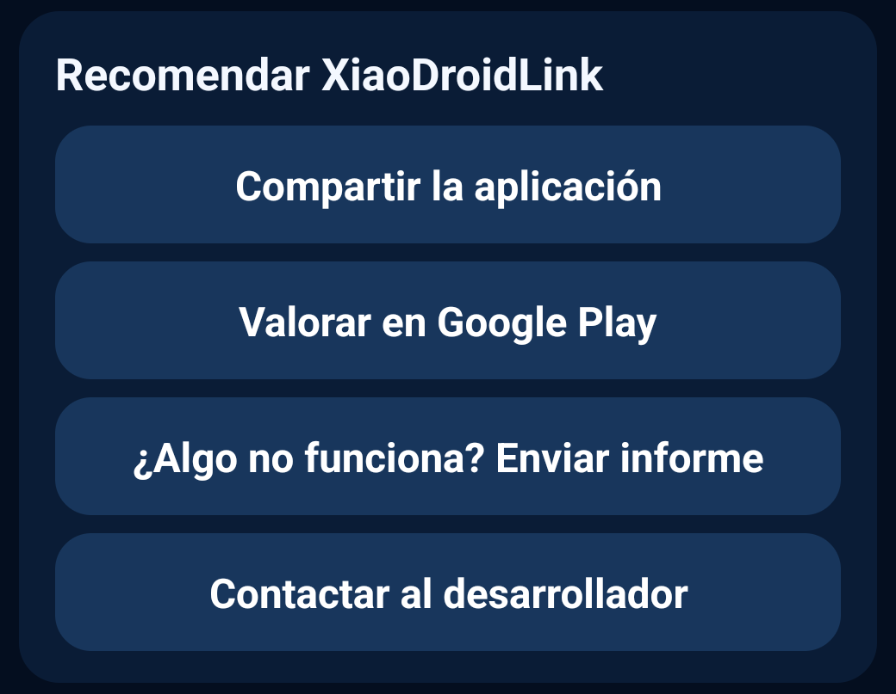 | 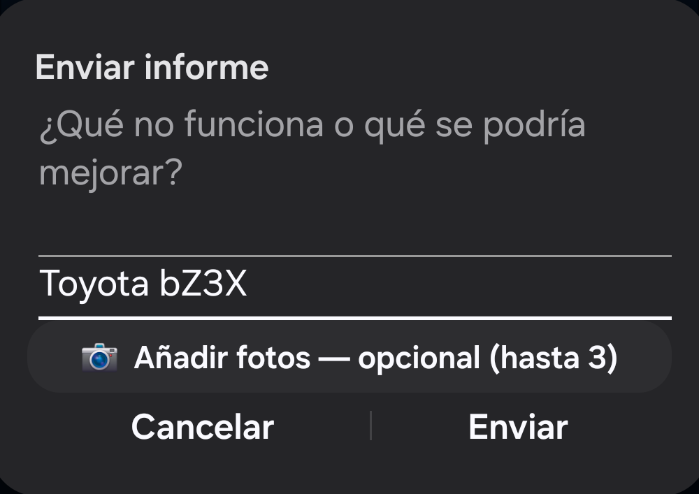 |

1. En el teléfono abre XiaoDroidLink, baja hasta «Recomendar XiaoDroidLink» y pulsa **«¿Algo no funciona? Enviar informe»**. Si no consigues conectar, la configuración tiene el mismo botón: «¿No lo consigue? Enviar informe al desarrollador».
2. En el formulario escribe brevemente **qué no funciona o qué se podría mejorar**.
3. En **«Coche»** indica marca y modelo, p. ej. «Toyota bZ3X». Si el teléfono ya se conectó al coche, se rellena solo.
4. Si quieres, pulsa **«📷 Añadir fotos — opcional»** y elige hasta 3 fotos, p. ej. la pantalla del coche con el error. El informe también se envía sin fotos.
5. Pulsa **«Enviar»**: se abre el correo con un mensaje listo para xiaodroidlink@lifestyle.salon, con el registro y las fotos adjuntos. Si tienes varias apps de correo, elige una. Queda pulsar Enviar en el correo: sin eso el mensaje no se envía.

Si el teléfono no tiene app de correo, la app ofrece otra para enviar el informe, o escribe a xiaodroidlink@lifestyle.salon.

## Registros de diagnóstico

En la app:

```text
Diagnostics -> Show log
```

Archivo en el teléfono:

```text
Android/data/salon.lifestyle.xiaodroidlink/files/probe.log
```

## Support

**Funciones extra mediante un ordenador** (la música sigue al bloquear el teléfono; pantalla del teléfono casi negra durante el viaje): [configuración única con nuestro asistente (en inglés)](../docs/EXTRAS_ADB.md).

Soporte: xiaodroidlink@lifestyle.salon
