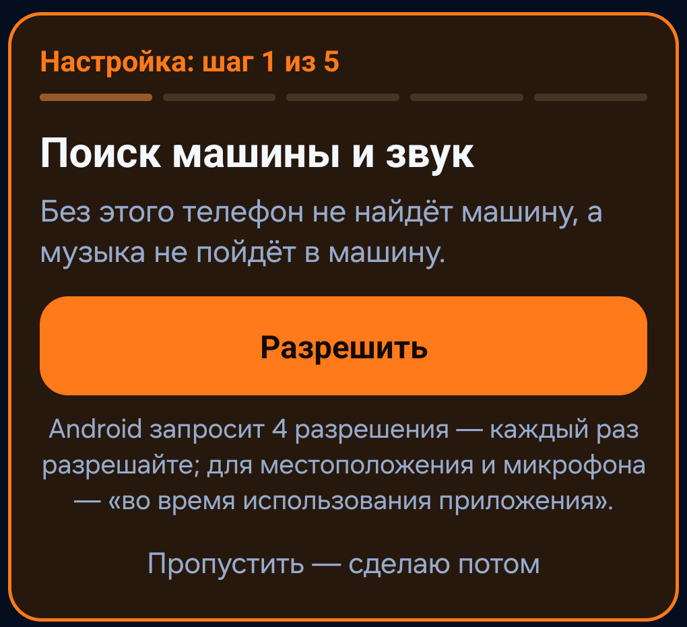
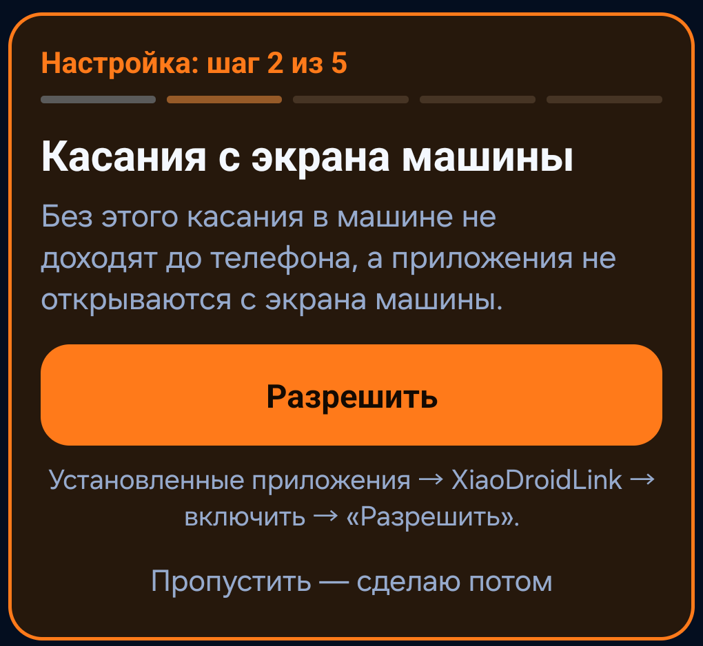
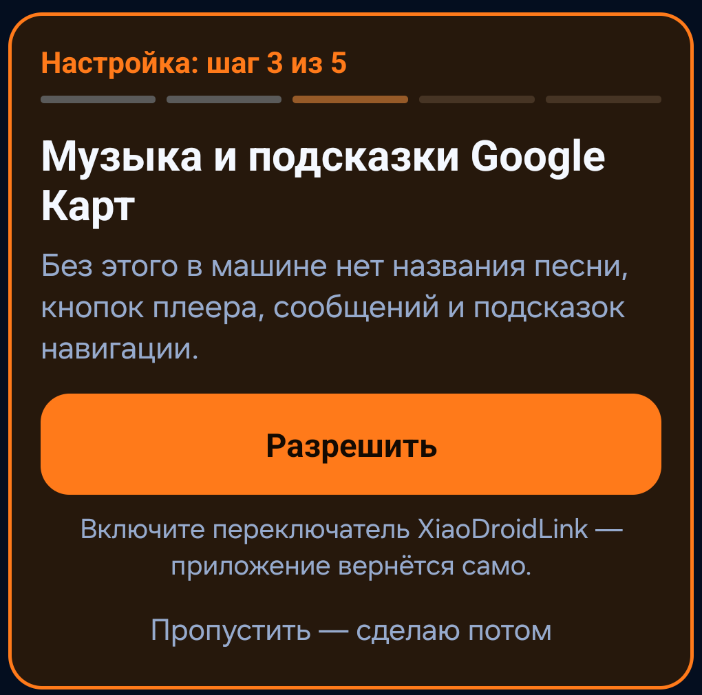
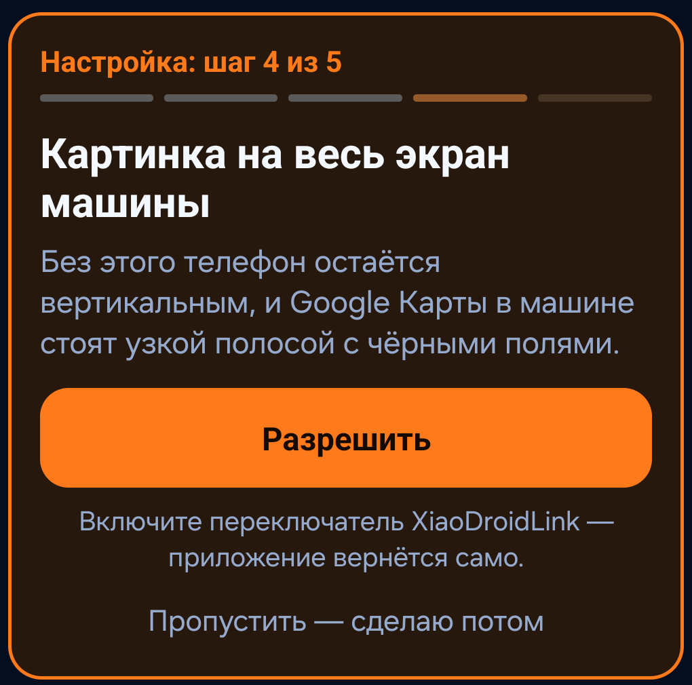
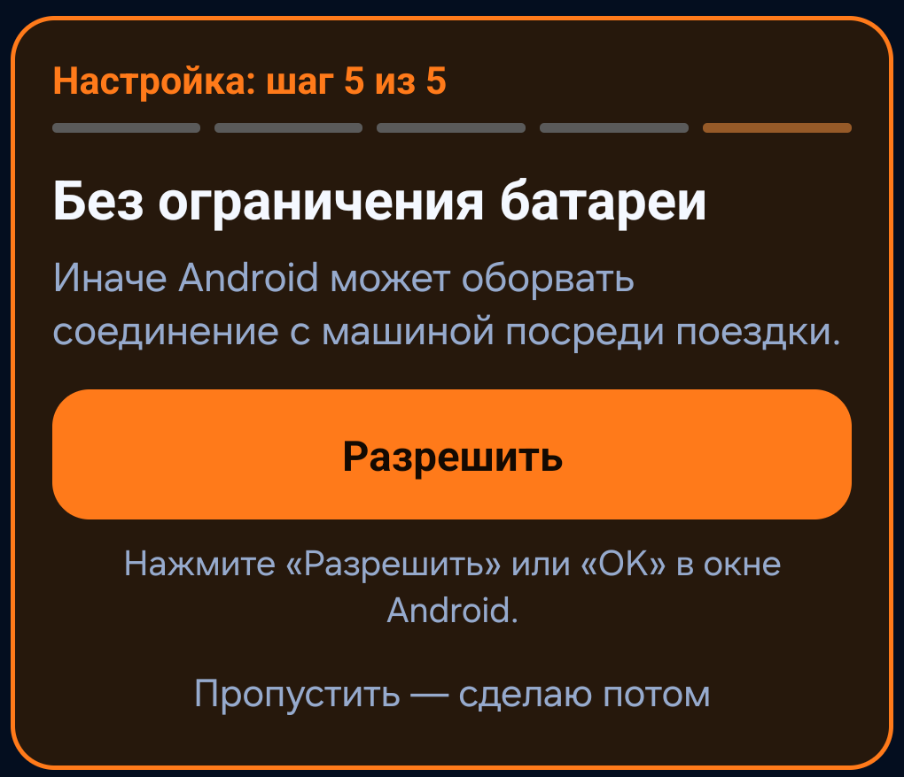
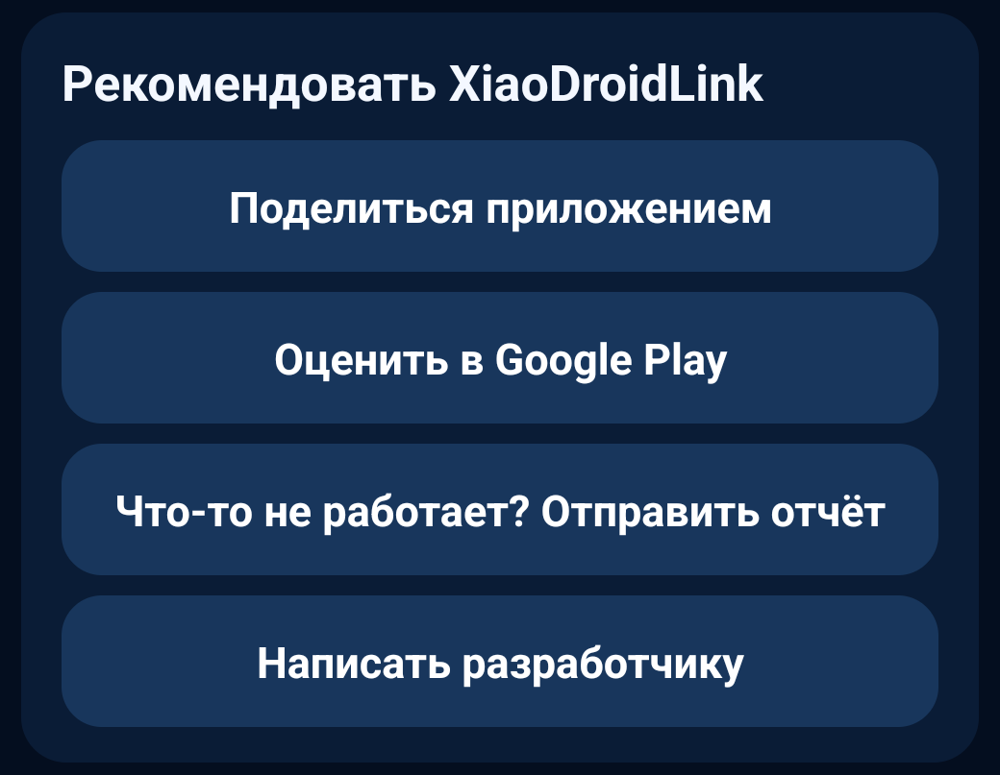
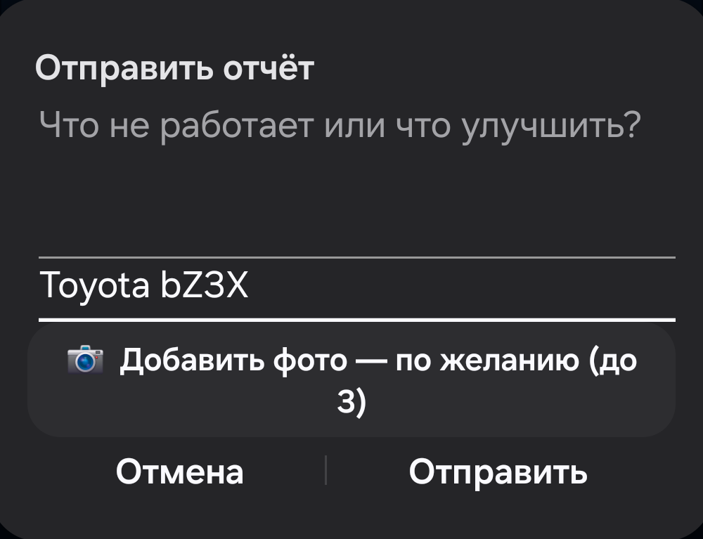

# XiaoDroidLink — краткая инструкция

Языки: [English](../README.md) · [Українська](README.ua.md) · [中文](README.zh.md) · [Français](README.fr.md) · [Español](README.es.md) · [Deutsch](README.de.md) · [Polski](README.pl.md) · [Қазақша](README.kk.md) · [Azərbaycanca](README.az.md) · [Oʻzbekcha](README.uz.md) · [Тоҷикӣ](README.tg.md) · [ქართული](README.ka.md) · [Հայերեն](README.hy.md) · [Кыргызча](README.ky.md) · [Русский](README.ru.md)

XiaoDroidLink подключает Android-телефон к экрану машины через ICCOA CarLink: панель с часами, погодой, музыкой, картой и сообщениями, экран телефона в машине с управлением касанием, навигация и помощник машины на вашем языке. Проверено на Xiaomi YU7; по отзывам пользователей работает и на других машинах с CarLink (например, китайские Toyota).

**Работает с машинами с CarLink (ICCOA).** Пользователи уже подтвердили работу с машинами Xiaomi (YU7, SU7), Toyota (RAV4, Camry 80), Nissan (X-Trail T32), Haval (Xiaolong Max), Deepal (S05), GAC (Aion Y Plus), Wuling (Starlight 730), Lynk & Co (08) и Jetta (VS8). Другая машина с CarLink — попробуйте и отправьте отчёт из приложения, мы разберёмся.

Это независимое приложение, не официальный продукт Xiaomi, Samsung, ICCOA, Android Auto или Google.

## Установка

XiaoDroidLink есть в Google Play: [https://play.google.com/store/apps/details?id=salon.lifestyle.xiaodroidlink](https://play.google.com/store/apps/details?id=salon.lifestyle.xiaodroidlink). Обновления приходят автоматически. Нужен Android 13 или новее.

## Первая настройка

После установки XiaoDroidLink сам проведёт через настройку: вверху главного экрана появляется оранжевая карточка **«Настройка: шаг 1 из 5»**. На карточке написано, зачем нужно это разрешение, а под кнопкой — что нажать. Нажимайте оранжевую **«Разрешить»** и делайте, что написано под ней. Шаг можно пропустить («Пропустить — сделаю потом»): тогда вместо карточки будет строка «Пропущено шагов настройки» с кнопкой **«Настроить сейчас»**. Когда всё разрешено, карточка исчезает.

| 1 | 2 | 3 |
|---|---|---|
|  |  |  |

| 4 | 5 |
|---|---|
|  |  |

**Шаг 1. Поиск машины и звук.** Нажмите «Разрешить». Android по очереди покажет 4 окна:

| Окно Android | Что нажать |
|---|---|
| Доступ к местоположению | «Точное», затем вариант «во время использования приложения» |
| Запись аудио (микрофон) | вариант «во время использования приложения» |
| Поиск устройств поблизости | «Разрешить» |
| Отправка уведомлений | «Разрешить» |

**Шаг 2. Касания с экрана машины** (специальные возможности).
1. Нажмите «Разрешить», прочитайте пояснение и нажмите «Согласен». Откроются «Специальные возможности» (Accessibility).
2. Откройте раздел со сторонними приложениями:
   - Samsung: **«Установленные приложения»** (Installed apps);
   - Xiaomi, Redmi, POCO: **«Скачанные приложения»**;
   - другие телефоны: «Скачанные» или «Установленные приложения».
3. Нажмите на пункт **«XiaoDroidLink: управление с машины»** (на английском — «XiaoDroidLink: car touch controls»).
4. Включите **переключатель вверху** (Выкл. → Вкл.).
5. Android спросит, дать ли полный контроль над устройством, — нажмите **«Разрешить»** (Allow).
6. Ниже есть переключатель **«Ярлык …»** (shortcut) — **не включайте его**: случайное касание кнопки или жеста выключает управление с машины.
7. Вернитесь в XiaoDroidLink кнопкой «Назад».

**Шаг 3. Музыка и подсказки Google Карт** (доступ к уведомлениям). Нажмите «Разрешить». Откроется список **«Доступ к уведомлениям»** (Notification access): нажмите на **XiaoDroidLink** и подтвердите «Разрешить» (Allow). Приложение вернётся само.

**Шаг 4. Картинка на весь экран машины.** Нажмите «Разрешить». Откроется страница XiaoDroidLink **«Изменение системных настроек»** (Change system settings): включите переключатель **разрешения** (Allow permission). Приложение вернётся само.

**Шаг 5. Без ограничения батареи.** Нажмите «Разрешить». Android спросит, отключить ли оптимизацию батареи: нажмите **«OK»** на Samsung или **«Разрешить»** на других телефонах.

## Первое подключение

1. Откройте CarLink на экране машины.
2. Откройте XiaoDroidLink и нажмите «Подключить».
3. Android попросит разрешение на трансляцию экрана: выберите **«Весь экран»** и нажмите **«Начать»**.
4. Введите 6-значный код с экрана машины и разрешите подключение к Wi‑Fi машины.

Дальше телефон подключается сам, когда вы садитесь в машину.

## Голосовые команды XiaoDroidLink — в любой машине

- 🎤 на виджете карты: скажите адрес — маршрут проложится.
- 🎤 на карточке музыки: скажите название песни или исполнителя — песня включится.

## Помощник машины на вашем языке

**Только для машин Xiaomi.** В других машинах кнопка на руле включает собственного помощника машины; какие команды он понимает, зависит от модели авто.

С версии 7.95 включён сразу (в машинах Xiaomi). Нажмите левое колёсико на руле, скажите команду (например, «открой багажник») — телефон скажет её машине по-китайски. Скажите «команды», чтобы увидеть список на экране машины, или: Настройки → «Команды помощника». Звонки: «позвони маме». Ответ машины показывается на экране по-русски. Выключить: Настройки → «Помощник машины на вашем языке».

## Как отправить отчёт или предложение

Если что-то не работает или есть идея, как сделать лучше, напишите разработчику прямо из приложения. К письму само прикладывается всё нужное для разбора: модель телефона, версия Android, разрешения и лог.

| Кнопка в приложении | Форма отчёта |
|---|---|
|  |  |

1. На телефоне откройте XiaoDroidLink, прокрутите вниз до раздела «Рекомендовать XiaoDroidLink» и нажмите **«Что-то не работает? Отправить отчёт»**. Если не получается подключиться, такая же кнопка есть в настройке: «Не получается? Отправить отчёт разработчику».
2. Коротко напишите, **что не работает или что улучшить**.
3. В поле **«Машина»** укажите марку и модель, например «Toyota bZ3X». Если телефон уже подключался к машине, поле заполнится само.
4. По желанию нажмите **«📷 Добавить фото — по желанию»** и выберите до 3 фото, например экран машины с ошибкой. Без фото отчёт тоже отправляется.
5. Нажмите **«Отправить»**: откроется почта с готовым письмом на xiaodroidlink@lifestyle.salon, лог и фото уже вложены. Если почтовых программ несколько, выберите одну. Останется нажать «Отправить» в почте — без этого письмо не уйдёт.

## Подробнее

Подробная инструкция на английском: [User guide](../README.md) · [Все функции](../docs/FEATURES.md) · [Виджеты](../docs/WIDGETS.md).

Ошибки на экране и что с ними делать — на русском: [Решение проблем](../docs/TROUBLESHOOTING.ru.md).

**Дополнительные функции через компьютер** (музыка не останавливается, когда блокируете телефон; почти чёрный экран телефона в дороге): [одноразовая настройка нашим помощником](../docs/EXTRAS_ADB.ru.md).

Вопросы и проблемы: xiaodroidlink@lifestyle.salon
