# XiaoDroidLink — 用户指南

语言：[English](../README.md) · [Українська](README.ua.md) · [中文](README.zh.md) · [Français](README.fr.md) · [Español](README.es.md) · [Deutsch](README.de.md) · [Polski](README.pl.md) · [Қазақша](README.kk.md) · [Azərbaycanca](README.az.md) · [Oʻzbekcha](README.uz.md) · [Тоҷикӣ](README.tg.md) · [ქართული](README.ka.md) · [Հայերեն](README.hy.md) · [Кыргызча](README.ky.md) · [Русский](README.ru.md)

XiaoDroidLink 可以通过 CarLink 将 Android 手机连接到小米 YU7 车机屏幕。它可以在车机上显示仪表盘或手机屏幕，控制音乐，打开选定应用，把车机触摸操作传回手机，并通过屏幕投射显示 Google Maps。

**适用于支持 CarLink（ICCOA）的汽车。** 用户已确认可用于小米、丰田、日产、哈弗、深蓝、广汽、五菱和领克。其他支持 CarLink 的汽车？请试用并在应用内发送报告，我们会解决。

这是一个独立项目，不是 Xiaomi、Samsung、ICCOA、Android Auto 或 Google 的官方产品。

## 功能

- 连接小米 YU7 CarLink。
- 输入车机屏幕上的 6 位验证码完成配对。
- 由小组件组成的主屏幕：最多三个屏幕、五种预设布局、23 个小组件（地图、下一个转弯、车速、测速摄像头、充电站、回家/公司路线、音乐、消息、联系人、日历、手机应用窗口等）。可在车机屏幕上排列、调整大小和设置：齿轮 → 小组件。
- 提供八种设计，每种都有地图、媒体和行程预览。底部的“屏幕 1/3 ›”按钮可切换三个实时屏幕，齿轮按钮可打开设计目录。
- 来电卡片，带“接听”和“拒接”按钮。
- 手机屏幕模式：在车机屏幕上显示手机应用。
- 通过 Android 无障碍服务把车机触摸操作传回手机。
- 媒体控制：播放/暂停、上一首、下一首。
- 通过手机屏幕投射在仪表盘中显示所选地图应用；默认使用 Google Maps。
- 当蓝牙音频不可用时，可通过 CarLink 传输音频。
- 可选择要显示在车机中的应用。
- 语音提醒：测速摄像头和空袭警报，在驾驶员头枕中以应用语言播报（手机没有该语言的语音时用英语）。会加载您所在国家的全部测速摄像头，在国外也一样。
- 用你的语言使用车机助手：按方向盘按钮说出指令，手机用中文转告车辆。
- 支持 15 种语言：English、Українська、中文、Français、Español、Deutsch、Polski、Қазақша、Azərbaycanca、Oʻzbekcha、Тоҷикӣ、ქართული、Հայերեն、Кыргызча、Русский。

## 视频

英文演示（49 秒）：

[](https://www.youtube.com/shorts/3C1UO75dUE4)

每项功能和小组件的详细说明（英文）：[All features](../docs/FEATURES.md) · [Home screen widgets](../docs/WIDGETS.md)。

## 从 Google Play 安装

XiaoDroidLink 已在 Google Play 上架。

1. 在手机上用 Google Play 打开 XiaoDroidLink：[https://play.google.com/store/apps/details?id=salon.lifestyle.xiaodroidlink](https://play.google.com/store/apps/details?id=salon.lifestyle.xiaodroidlink)
2. 点按“安装”。
3. 打开 XiaoDroidLink。

之后更新会通过 Google Play 自动推送。

如果你之前用 APK 文件安装过 XiaoDroidLink，请先卸载：APK 和 Google Play 版本签名不同，Google Play 无法覆盖安装。重新安装后，请再次输入车机屏幕上的代码。

## 适用的手机

- Android 13 或更新版本。
- 已在车上用 Samsung Galaxy S25 Ultra 测试。
- 视频编码器较弱的手机（许多联发科和紫光展锐机型，如 Infinix、Tecno、部分 Galaxy A）会向车机发送比例相同、稍小的画面。“无车预览”在这些手机上可用（已在 Infinix Hot 40 上验证）；车上尚未测试。如果画面没有铺满屏幕或没有显示，请发邮件至 xiaodroidlink@lifestyle.salon。

## 截图

在手机应用中可通过“无车预览”查看仪表盘。

| 车机屏幕预览 |
|---|
| 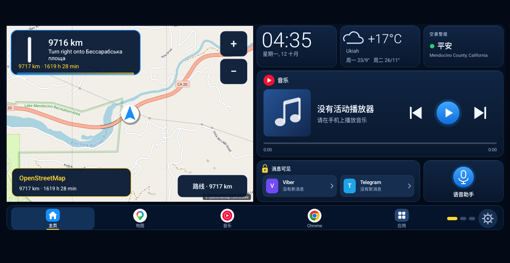 |

| 第 2 屏（共 3 屏）：媒体 | 第 3 屏（共 3 屏）：行程 |
|---|---|
| 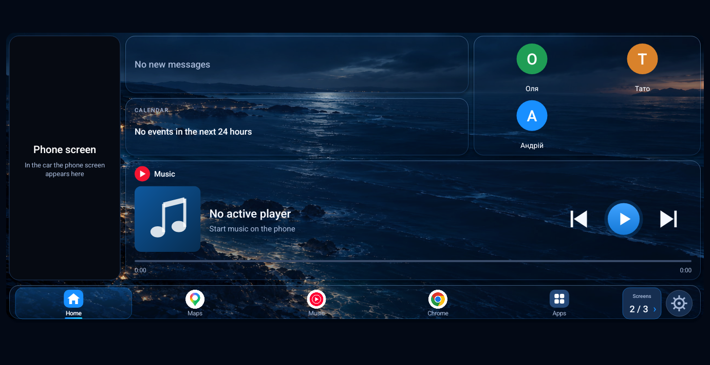 | 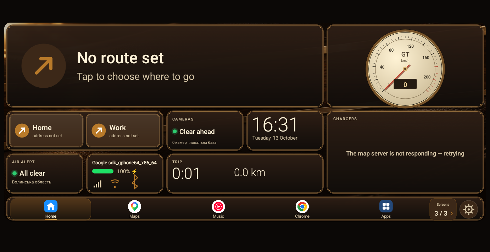 |

| 设计目录 |
|---|
| 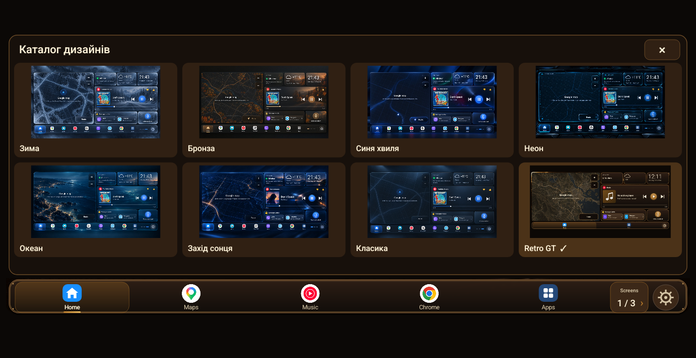 |

| 主屏幕 | 权限 |
|---|---|
| 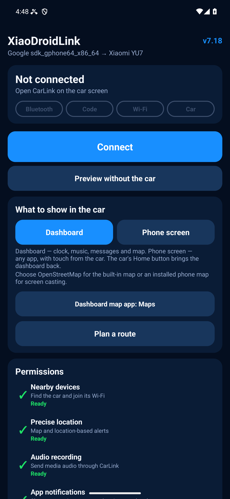 | 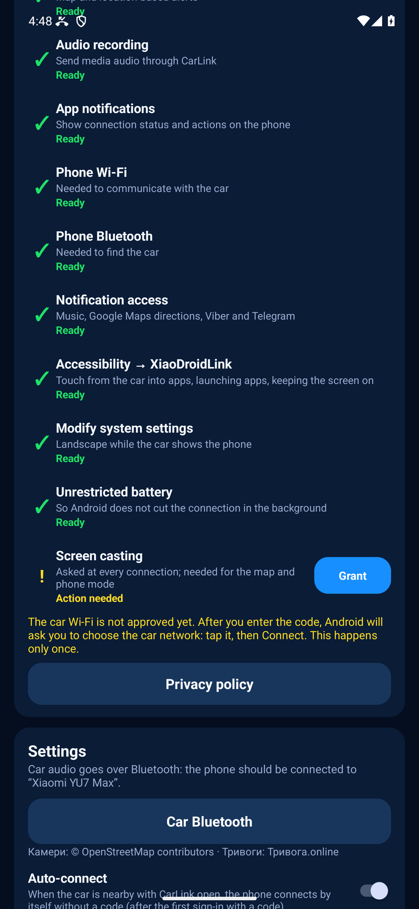 |

| 设置 |
|---|
| 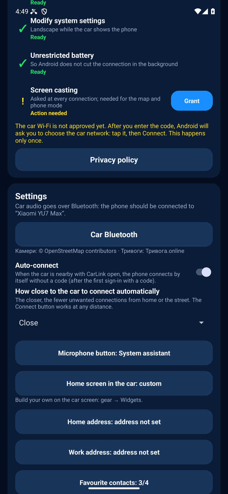 |

## 首次设置

安装后，XiaoDroidLink 会自己引导你完成设置：主界面顶部会出现橙色卡片 **“设置：第 1 步，共 5 步”**。卡片写明为什么需要这个权限，按钮下方写着要点什么。点橙色的 **“允许”**，按下面的提示操作。某一步可以跳过（“跳过，稍后再设置”），这时卡片会变成“已跳过的设置步骤”一行和 **“立即设置”** 按钮。全部授权后，卡片会消失。

| 1 | 2 | 3 |
|---|---|---|
| 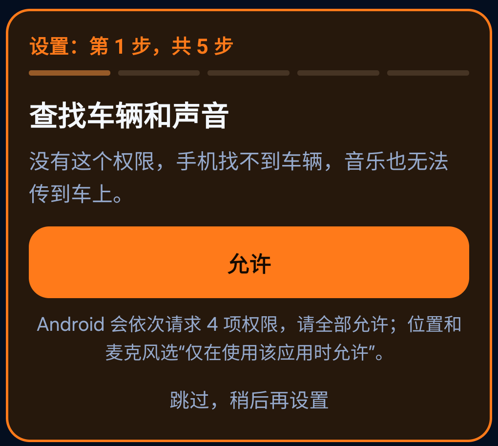 | 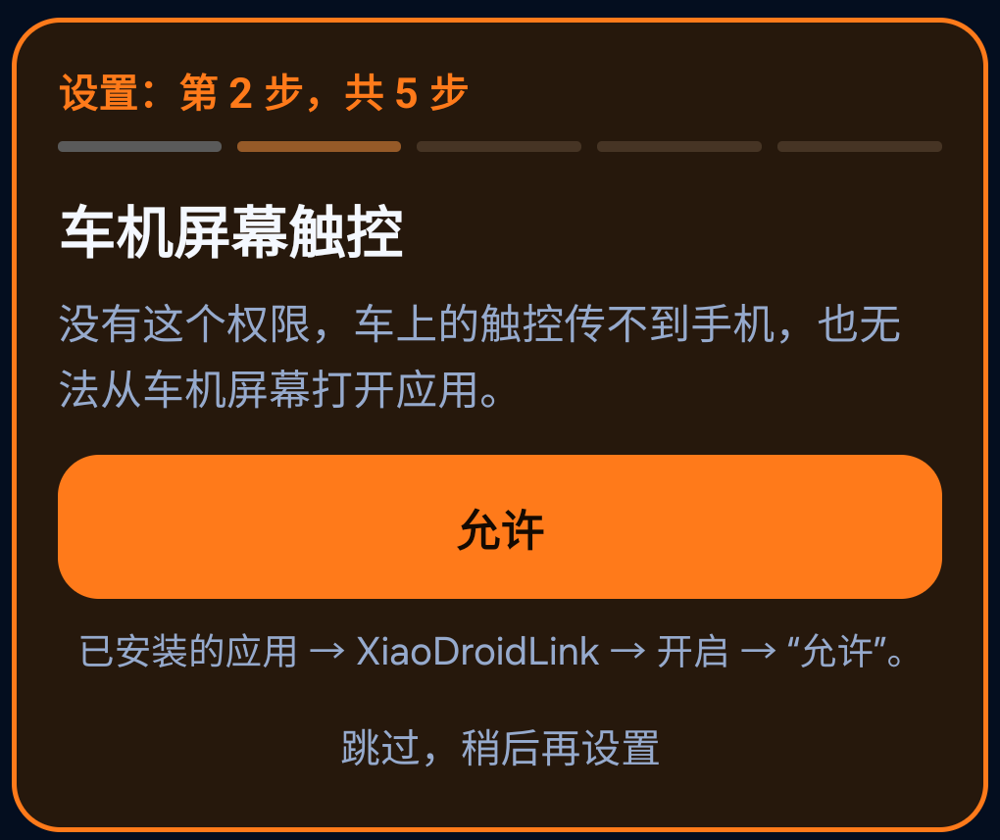 | 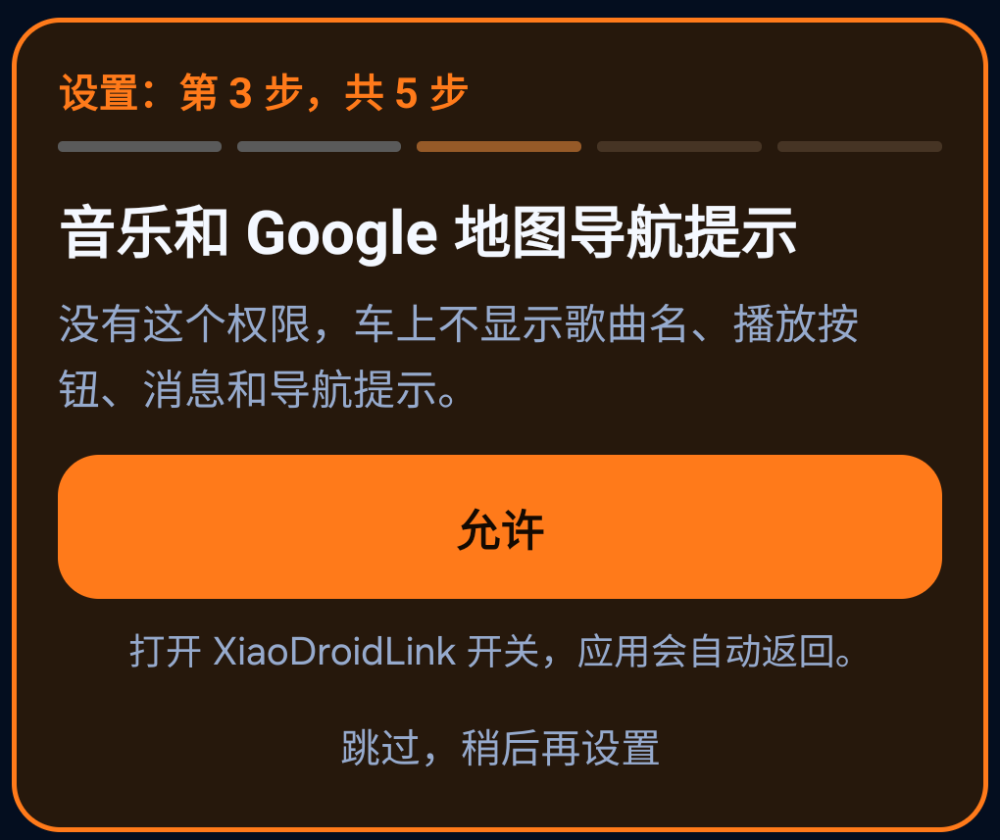 |

| 4 | 5 |
|---|---|
| 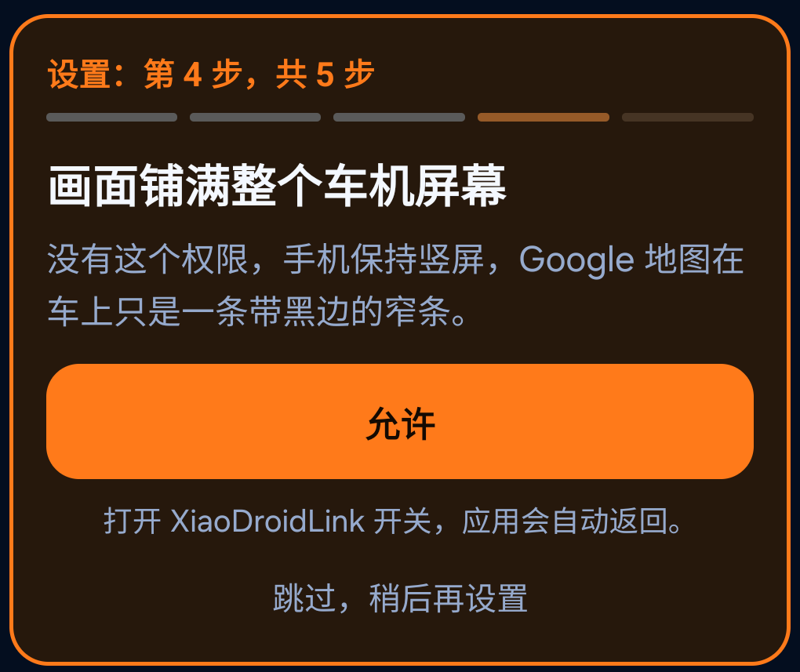 | 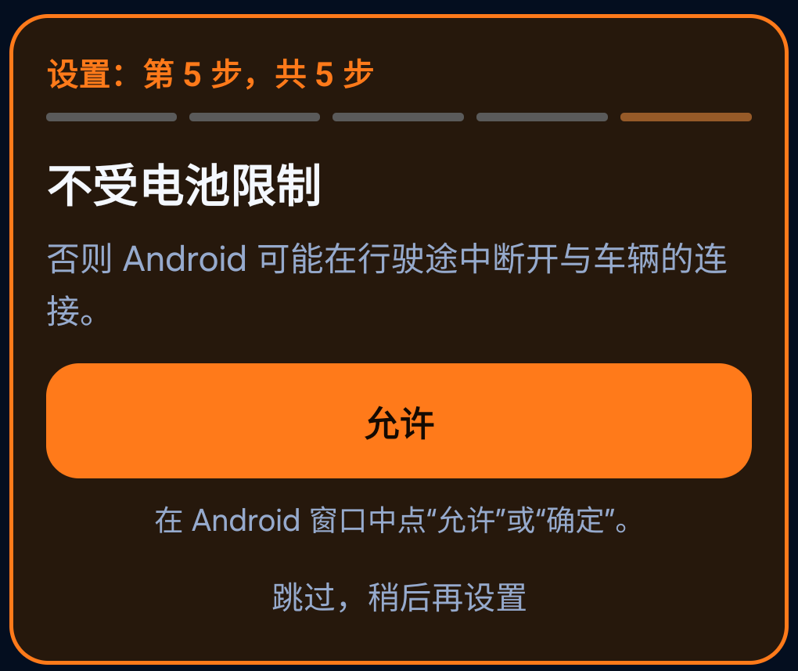 |

**第 1 步：查找车辆和声音。** 点“允许”。Android 会依次弹出 4 个窗口：

| Android 窗口 | 点什么 |
|---|---|
| 访问设备位置 | “精确”，然后“仅在使用该应用时允许” |
| 录制音频（麦克风） | “仅在使用该应用时允许” |
| 查找附近设备 | “允许” |
| 发送通知 | “允许” |

**第 2 步：车机屏幕触控**（无障碍）。
1. 点“允许”，阅读说明后点“同意”，会打开“无障碍”。
2. 打开第三方应用分区：三星 — **“已安装的应用”**；小米、红米、POCO — **“已下载的应用”**；其他手机 — “已下载”或“已安装的应用”。
3. 点 **“XiaoDroidLink：车机触控”**。
4. 打开**顶部开关**。
5. Android 会询问是否允许完全控制设备 — 点 **“允许”**。
6. 下方有 **“… 快捷方式”** 开关 — **不要开启**：误触会关闭车机控制。
7. 用返回键回到 XiaoDroidLink。

**第 3 步：音乐和 Google 地图提示**（通知使用权）。点“允许”，会打开 **“通知使用权”** 列表：点 **XiaoDroidLink**，再点“允许”确认。应用会自动返回。

**第 4 步：画面铺满车机屏幕。** 点“允许”，会打开 XiaoDroidLink 的 **“修改系统设置”** 页面：打开**授权开关**。应用会自动返回。

**第 5 步：不限制电池。** 点“允许”。Android 会询问是否停止电池优化：三星点 **“确定/OK”**，其他手机点 **“允许”**。

第一次连接时，Android 还会请求投屏权限：选择 **“整个屏幕”**，然后点 **“开始”**。

如果某一步做不了，卡片上有“还是不行？向开发者发送报告”按钮，见 [发送报告或改进建议](#发送报告或改进建议)。

## 连接车辆

1. 在小米 YU7 屏幕上打开 CarLink。
2. 在手机上打开 XiaoDroidLink。
3. 点击 Connect。
4. 如果 Android 请求屏幕投射权限，选择 Entire screen 并点击 Start。
5. 车机屏幕会显示 6 位验证码。
6. 在 XiaoDroidLink 中输入验证码。
7. 连接后选择 Dashboard 或 Phone screen 模式。
8. 行程结束后，在应用或通知中点击 Disconnect。

## 通过车辆蓝牙通话和语音

音乐通过 CarLink（Wi‑Fi）传到车上。通话、导航语音和 ChatGPT 走车辆蓝牙，需要单独连接。请在停车时操作。

1. 按上面的步骤连接车辆，等待车机屏幕出现画面。
2. 手机上会出现通知 `车辆蓝牙未连接`，点按它。
3. 应用会自动断开连接并打开蓝牙设置。在列表中选择你的车。
4. 不要再点其他东西。几秒钟后应用会自动重新连接，画面恢复。
5. 检查：通话或 ChatGPT 的声音应从车内扬声器播放。

需要了解：

- 不要在启动 CarLink 之前提前连接车辆蓝牙。CarLink 启动时车辆会断开这种连接。可靠的方式是通过通知操作。
- 如果蓝牙显示已连接，但通话仍从手机播放，请再次点按同一通知并重新选择车辆。
- 手机不会自动连接车辆蓝牙。每次行程开始时需要手动选择一次车辆。
- 选择车辆的时间为 90 秒。超时后应用会在没有蓝牙的情况下回到车机画面，通知会再次出现。
- 之后不要关闭车机屏幕上的 CarLink。只要它保持打开，蓝牙在断线和重新连接后仍会保持。如果关闭后重新打开，需要重复以上步骤。
- 蓝牙已连接时，音乐会在画面出现约 10 秒后才在车内播放。这是有意的延迟，避免车辆断开蓝牙。
- CarLink 运行时 YU7 不接受蓝牙音乐，因此 `通过 CarLink 播放音频` 必须保持开启。
- 已在 Xiaomi YU7 Max 上测试。车辆偶尔仍会断开蓝牙，此时重复第 2–4 步。

## XiaoDroidLink 语音指令 — 适用于任何车型

- 地图小组件上的 🎤：说出地址，即可开始导航。
- 音乐卡片上的 🎤：说出歌曲或歌手，即可开始播放。

## 用你的语言使用车机助手

**仅限小米汽车。** 在其他车型上，方向盘按键会唤起车机自带的助手；它能理解哪些指令取决于车型。

车机助手（超级小爱）只听得懂中文。XiaoDroidLink 为其他语言的用户转述：用户用自己的语言说出指令，手机**用自己的扬声器**以中文复述，车辆执行。可以控制空调、座椅、车窗、前备箱、雨刮、灯光和屏幕主题。

支持用乌克兰语、俄语、英语、法语和西班牙语说指令，从 7.67 起还支持德语、波兰语、哈萨克语、阿塞拜疆语、乌兹别克语、塔吉克语、格鲁吉亚语、亚美尼亚语和吉尔吉斯语。这九种语言的指令已翻译，但尚未在车上测试。

如果你会说中文，直接对车机助手说就行，不需要这个功能。应用语言为中文时，手机会把听到的中文原样转述。

### 开启

1. 自 7.95 起助手默认开启。如需关闭：手机上 XiaoDroidLink → 设置 → **“用你的语言使用车机助手”** 开关。
2. 如果手机询问，允许使用麦克风。
3. 手机需要中文语音合成（Samsung 和 Google 一般自带）。如果没有，车机屏幕会提示：设置 → 文字转语音 → 安装中文。

开关关闭时，方向盘语音按钮仍和以前一样打开手机 AI（在“麦克风按钮”中选择的 ChatGPT、Gemini 或系统助手）。

### 使用

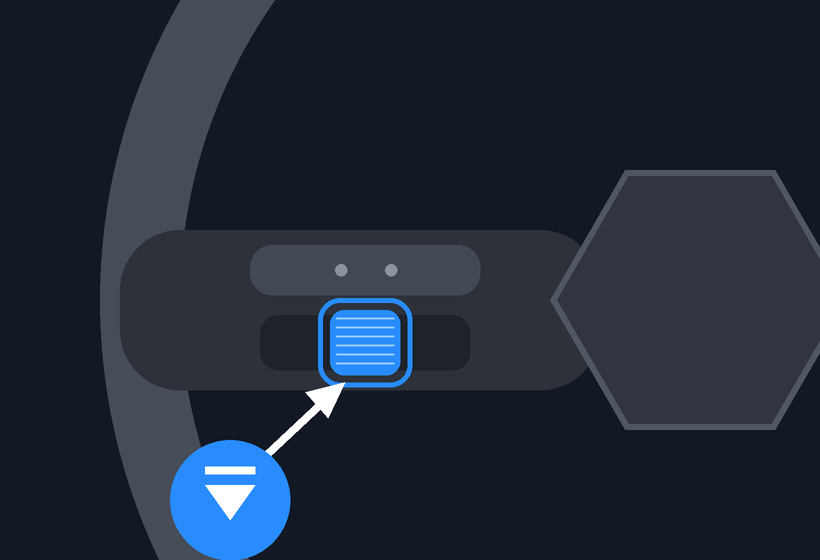

1. **按下方向盘左侧滚轮**（是按下，不是滚动）。车机助手被唤醒，手机同时开始聆听，车机屏幕显示“请说出要车辆做什么…”。
2. 用应用语言说出指令。
3. 约 3 秒后，手机用中文说出指令，车辆执行并用中文回答。如果手机没有识别出指令，车机屏幕显示“没听懂：…”。

说“人工智能”、“AI”、“ChatGPT”或“Gemini”可打开**手机 AI**：手机先让车机助手退出（“退出小爱”），再打开 AI。

**语音打电话：** 按方向盘按键，说“打电话给王芳”或“给妈妈打电话”。手机在通讯录中查找姓名并拨打；有多个匹配时，车机屏幕最多列出三个供选择。首次使用需在手机上允许访问通讯录和拨打电话。车机蓝牙未连接时手机不会拨打（否则通话会走手机扬声器），而是打开车辆选择并提示重新拨打。

**屏幕上的指令列表：**按方向盘按键后用应用语言说“指令”（如 commands），车机屏幕会打开列表；也可在车机上点齿轮 → **“🗣 助手指令”**（设置顶部）；手机上在“用你的语言使用车机助手”开关下方点 **“助手指令”**。列表只包含已在车上验证的指令，以及车辆无法语音控制的功能。

### 支持的指令

已在车上验证：温度调高、调低，温度调到指定度数；空调开、关；座椅加热（可加“驾驶员”“乘客”或“后排”）、通风、按摩；方向盘加热；后窗除霜；前挡除雾；后视镜加热、折叠、展开；车窗开、关、开一半、开条缝；前备箱开、关；后备箱开、关；充电口开、关；雨刮、雨刮洗涤；车内灯开、关；后雾灯；氛围灯颜色（如红色、蓝色）；浅色、深色模式；音量调到指定数值；雪地模式（车辆会确认）；按通讯录姓名打电话（10 月 27 日验证）。远光灯无法语音控制，请使用左侧拨杆，手机会提示。

这里只列出 2026 年 10 月 25–27 日在车上验证过的指令。手机还能转述更多指令（悬架、收音机），仍在测试中，验证后会补充到这里。是否执行由车辆决定：部分操作可能只在驻车时允许。

### 限制

- 必须使用**方向盘按钮**。手机无法用“小爱同学”唤醒车机助手：车机只会短暂闪烁，不继续聆听（所有语音唤醒设置都试过）。
- 手机需放在**车内**（充电座或支架上），不要放在口袋或包里：车辆需要听到手机扬声器的声音。

## 建议设置

- 使用 Google Maps 或手机屏幕模式时保持手机解锁。
- 如果需要仪表盘地图，打开 Google Maps in the dashboard。可在 Dashboard map app 中选择 Waze 或其他已安装地图应用。
- 只有当车辆无法接收蓝牙音频时，才打开 Audio through CarLink。
- 在 Apps in the car 中添加需要的应用。
- 第一次成功连接后，可以保持 Auto-connect 开启。

## 常见问题

手机和车机屏幕上全部提示的完整列表及设置截图（英文）：[屏幕错误与解决方法](../docs/TROUBLESHOOTING.md)。

### 找不到车辆

- 先在车机屏幕上打开 CarLink。
- 关闭车机上的 CarLink，然后重新打开。
- 在手机上关闭并重新打开 Bluetooth。
- 确认已授予 location 权限。
- 将手机靠近车辆。

### 验证码不被接受

- 输入车机屏幕上最新的验证码。
- 如果验证码已变化，请输入新的验证码。
- 关闭并重新打开车机上的 CarLink。
- 点击 Disconnect，然后重新开始。

### 车辆 Wi-Fi 无法连接

- 连接过程中保持车机上的 CarLink 打开。
- 关闭 VPN，或把 XiaoDroidLink 加入 VPN 例外。
- 在手机上关闭并重新打开 Wi-Fi。
- 如果手机连接到旧网络，请忘记旧的车辆 Wi-Fi 网络。

### 屏幕投射无法开始

- Android 请求权限时选择 Entire screen。
- 保持手机解锁。
- 确认 XiaoDroidLink 没有电池限制。
- 关闭并重新打开应用。

### 车机触摸无效

- 在 Android 无障碍设置中启用 XiaoDroidLink。
- 如果 Android 阻止此选项，请在应用信息页面允许 restricted settings。
- 启用无障碍后断开连接并重新连接。

### 音乐控制无效

- 授予 XiaoDroidLink notification access。
- 在手机上开始播放音乐。
- 检查 Music button player 设置。
- 授予通知权限后重新打开 XiaoDroidLink。

### 声音仍从手机播放

- 将手机连接到车辆蓝牙。
- 如果蓝牙音频不可用，打开 Audio through CarLink。
- 更改音频设置后断开并重新连接。

### 地图不显示

- 打开 Google Maps in the dashboard。
- 允许屏幕投射。
- 保持手机解锁。
- 在手机上启动所选地图应用的导航。

### 后台连接中断

- 关闭 XiaoDroidLink 的电池限制。
- 不要强制关闭应用。
- 保持活动连接通知。
- 如果手机有自带电池管理器，把 XiaoDroidLink 加入白名单。

## 发送报告或改进建议

如果有功能不好用，或者你有改进的想法，可以直接在应用里写给开发者。分析所需的信息会自动附上：手机型号、Android 版本、权限和日志。

| 应用中的按钮 | 报告表单 |
|---|---|
| 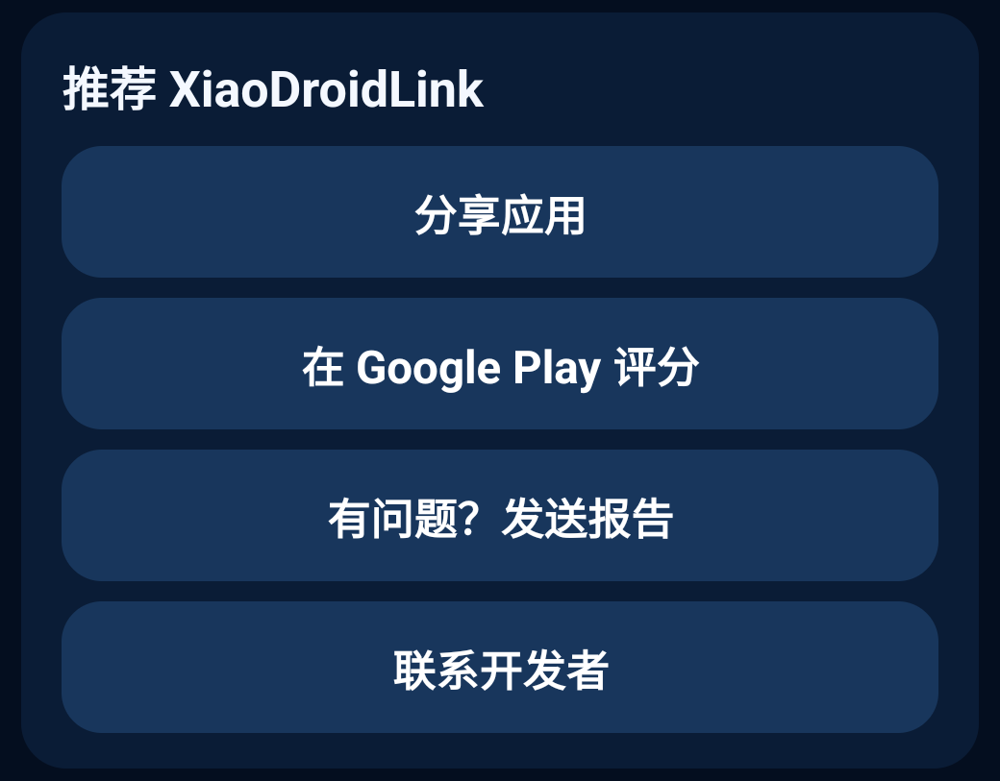 | 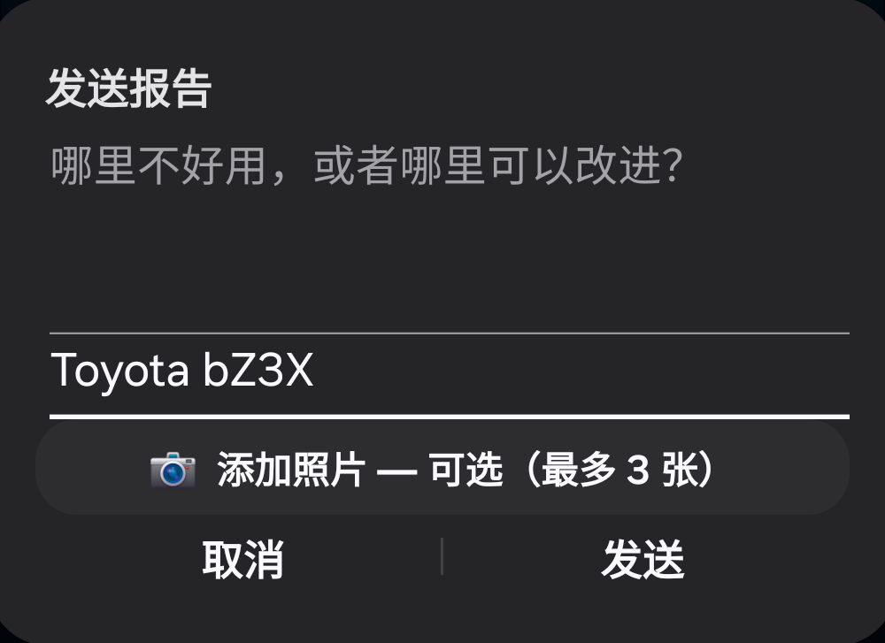 |

1. 在手机上打开 XiaoDroidLink，向下滑到“推荐 XiaoDroidLink”，点 **“有问题？发送报告”**。如果连不上，设置向导里也有同样的按钮：“还是不行？向开发者发送报告”。
2. 在表单中简单写下 **哪里不好用，或者哪里可以改进**。
3. 在 **“车型”** 里填写品牌和型号，例如“丰田 bZ3X”。如果手机已经连接过车机，会自动填好。
4. 可以点 **“📷 添加照片 — 可选”**，选择最多 3 张照片，例如车机屏幕上的报错。不加照片也能发送。
5. 点 **“发送”**：邮件应用会打开一封写好的邮件，收件人 xiaodroidlink@lifestyle.salon，日志和照片已附上。如果有多个邮件应用，选择其中一个。然后在邮件里点发送，否则邮件不会发出。

如果手机上没有邮件应用，应用会让你用其他应用发送，或者直接发邮件至 xiaodroidlink@lifestyle.salon。

## 诊断日志

应用内：

```text
Diagnostics -> Show log
```

手机文件：

```text
Android/data/salon.lifestyle.xiaodroidlink/files/probe.log
```

## Support

**通过电脑开启的附加功能**（锁定手机时音乐不中断；行驶中手机屏幕几乎全黑）: [用我们的助手一次性设置（英文）](../docs/EXTRAS_ADB.md).

支持：xiaodroidlink@lifestyle.salon
